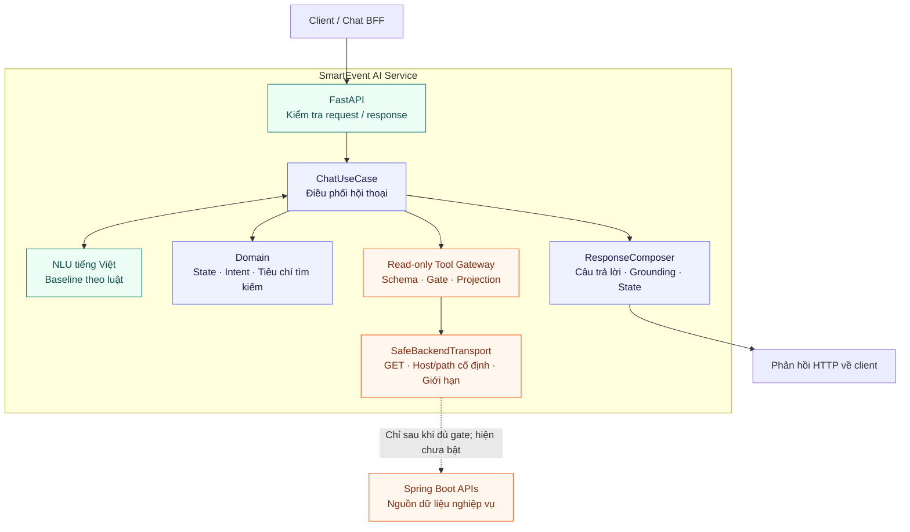

# SmartEvent AI Service

**Nền tảng trợ lý hội thoại tiếng Việt cho hệ thống vé sự kiện SmartEvent.**

[](https://github.com/smartevent-ticketing/ai-service/actions/workflows/ci.yml)


Dịch vụ được tổ chức theo **Clean Architecture**, tách xử lý hội thoại khỏi giao thức HTTP, cấu hình và kết nối backend. Mục tiêu là hỗ trợ người dùng tìm hiểu sự kiện, làm rõ nhu cầu chọn vé và nhận hướng dẫn trên SmartEvent trong phạm vi quyền truy cập được kiểm chứng.

> [!IMPORTANT]
> **Phiên bản 0.1.2 là nền tảng phát triển, chưa sẵn sàng cho production.** API hội thoại và bộ hiểu ngôn ngữ theo luật đã hoạt động; toàn bộ **14 business tool mặc định bị tắt**. LLM/QLoRA, RAG, JEV và cơ chế ủy quyền truy cập dữ liệu tài khoản chưa được tích hợp. Dịch vụ không thực hiện giữ chỗ, đặt vé, thanh toán hoặc hoàn tiền thay người dùng.

**Đi đến:** [Năng lực hiện tại](#năng-lực-hiện-tại) · [Tech stack](#tech-stack) · [Kiến trúc](#kiến-trúc) · [Chạy nhanh](#bắt-đầu-nhanh) · [API](#api) · [Cấu hình](#cấu-hình) · [Kiểm chứng](#kiểm-chứng-và-cicd) · [Tài liệu](#tài-liệu-và-lộ-trình)

## Năng lực hiện tại

| Thành phần | Hiện trạng |
| :--- | :--- |
| Hội thoại tiếng Việt | Nhận diện ý định bằng luật; trích xuất thành phố, số lượng, ngân sách và từ khóa tìm kiếm |
| Theo dõi ngữ cảnh | Truyền trạng thái giữa các lượt; hỗ trợ làm rõ ngân sách, cập nhật và xóa điều kiện đã hỗ trợ |
| Xếp hạng phương án vé | Hàm thuần xác định trong domain; chưa nối với tồn kho thật hoặc luồng đề xuất trực tiếp |
| Gateway nghiệp vụ | Có registry, schema, projection và gate kiểm soát; mọi tool vẫn tắt |
| HTTP transport | Giới hạn host/path, phương thức GET, thời gian, kích thước và cấu trúc JSON; chặn redirect và các đường dẫn GET có tác dụng ghi đã biết |
| Quan sát request | Sinh `x-request-id`, ghi trạng thái và độ trễ theo tuyến; middleware không ghi nội dung hội thoại, state hay credential |
| Công cụ dữ liệu | Chia tập xác định theo nhóm hội thoại và họ kịch bản; tạo manifest SHA-256 phục vụ tái lập |

Khi chưa có dữ liệu nghiệp vụ được xác minh, API trả `grounding: NO_LIVE_DATA` và giải thích giới hạn. Việc nhận diện được ý định tìm sự kiện không đồng nghĩa dịch vụ đã truy vấn backend.

## Tech stack

Các phiên bản dưới đây được lấy từ [`pyproject.toml`](pyproject.toml) và các lockfile của repository.

| Lớp | Công nghệ | Vai trò |
| :--- | :--- | :--- |
| Ngôn ngữ | **Python 3.12**; CI kiểm thử thêm **3.11** | Runtime và công cụ phát triển |
| HTTP API | **FastAPI 0.143.3**, **Starlette 1.8.0**, **Uvicorn 0.48.0** | REST API, middleware ASGI và máy chủ ứng dụng |
| Hợp đồng dữ liệu | **Pydantic 2.13.5**, **pydantic-settings 2.16.0** | Kiểm tra DTO và đọc cấu hình tiến trình |
| Kết nối backend | **HTTPX 0.28.1** | HTTP client bất đồng bộ, được bao bởi transport giới hạn quyền |
| Cấu hình và schema | **PyYAML 6.0.3**, **jsonschema 4.26.0** | Registry/gate YAML và kiểm tra JSON Schema |
| Xử lý nghiệp vụ | **Python standard library**, `dataclasses`, `Decimal` | Trạng thái hội thoại, bất biến và tính toán trong domain |
| Kiểm thử | **pytest 9.0.2**, **pytest-asyncio 1.3.0**, **pytest-cov 7.0.0** | Unit, HTTP, contract và kiểm thử hồi quy bảo mật |
| Chất lượng mã | **Ruff 0.14.14**, **Mypy 1.19.1** | Lint, định dạng và kiểm tra kiểu |
| Phụ thuộc và đóng gói | **uv 0.12.6**, **pip**, **setuptools 82.0.1**, **pip-audit 2.10.1** | Khóa phụ thuộc theo hash, build wheel và kiểm tra advisory |
| CI và container | **GitHub Actions**, **Docker** | Ma trận Windows/Linux, kiểm tra wheel độc lập và Docker smoke test |

**Ngữ cảnh hệ thống:** SmartEvent sử dụng Next.js/BFF ở phía web và Spring Boot ở phía backend nghiệp vụ. Đây là các hệ thống tích hợp bên ngoài; AI Service hiện không kết nối trực tiếp cơ sở dữ liệu nghiệp vụ và không yêu cầu GPU hoặc model weights để chạy baseline.

## Kiến trúc



Sơ đồ thể hiện luồng xử lý và ranh giới tích hợp. Đường nét đứt là kết nối nghiệp vụ chưa được bật trong cấu hình mặc định.

### Quy tắc phụ thuộc

- **`domain`** chỉ dùng thư viện chuẩn Python, chứa giá trị, trạng thái và bất biến nghiệp vụ.
- **`application`** phụ thuộc domain và các port; không phụ thuộc framework, HTTP hay định dạng cấu hình.
- **`adapters`** triển khai các port và ánh xạ dữ liệu ở ranh giới HTTP, NLU và backend.
- **`infrastructure`** đọc settings và lắp ghép các implementation tại composition root.

### Ranh giới READ_ONLY

1. Tool nghiệp vụ chỉ được dùng **GET trên đường dẫn đã đăng ký**; không nhận URL hoặc phương thức tùy ý. Một endpoint dùng GET vẫn có thể bị chặn nếu có tác dụng thay đổi dữ liệu.
2. Dữ liệu phản hồi phải qua kiểm tra schema và **allowlist projection** trước khi sử dụng; không chuyển raw JSON backend, QR, token hoặc credential vào ngữ cảnh model.
3. Đọc dữ liệu riêng tư phải có cơ chế **CUSTOMER_SELF_ONLY** đã được kiểm chứng. State hoặc định danh do client gửi không phải bằng chứng xác thực.
4. Mọi tool mặc định tắt. Unit test thành công không đủ để bật tool; `SPEC_TEST_ONLY`, `BLOCKED` và `NOT_RUN` không phải `PASS`.
5. Không khẳng định tồn kho đầy đủ hoặc theo thời gian thực từ kết quả phân trang chưa đầy đủ, danh sách bị cắt hoặc snapshot chưa xác minh.

`POST /api/v1/chat` là thao tác gửi câu hỏi đến AI Service, không cấp quyền ghi dữ liệu nghiệp vụ SmartEvent.

## Bắt đầu nhanh

**Yêu cầu:** Git và Python **3.12** được khuyến nghị; Python **3.11** cũng được kiểm thử trong CI. Docker chỉ cần khi chạy bằng container. Các lệnh dưới đây được thực hiện từ thư mục gốc repository.

### 1. Lấy mã nguồn và tạo môi trường

```bash
git clone https://github.com/smartevent-ticketing/ai-service.git
cd ai-service
```

**Windows — PowerShell**

```powershell
py -3.12 -m venv .venv
.\.venv\Scripts\Activate.ps1
Copy-Item .env.example .env
```

**Linux / macOS**

```bash
python3.12 -m venv .venv
source .venv/bin/activate
cp .env.example .env
```

Tệp `.env` dành cho cấu hình local và đã được loại khỏi Git. Nếu không tạo tệp này, dịch vụ dùng cấu hình mặc định và bản YAML được đóng gói sẵn.

### 2. Cài đặt từ lockfile

```bash
python -m pip install --require-hashes -r requirements/dev.lock
python -m pip install --no-deps --no-build-isolation -e .
python scripts/verify_dependency_locks.py
```

### 3. Khởi động API

```bash
python -m uvicorn smartevent_ai.main:app --reload --host 127.0.0.1 --port 8001
```

Mở [Swagger UI](http://127.0.0.1:8001/docs) để thử API hoặc xem [OpenAPI JSON](http://127.0.0.1:8001/openapi.json). Baseline chạy được độc lập khi backend SmartEvent chưa khởi động vì tất cả business tool vẫn tắt.

### Chạy bằng Docker

```bash
docker build -t smartevent-ai-service:0.1.2 .
docker run --rm --name smartevent-ai -p 127.0.0.1:8001:8001 smartevent-ai-service:0.1.2
```

Container chạy bằng user không phải root, có healthcheck tại `/health/live` và sử dụng runtime lockfile có hash. Image nền hiện là `python:3.12-slim`; do tag này chưa cố định theo digest, lockfile Python không bảo đảm image luôn có byte giống hệt nhau qua các lần build.

## API

| Phương thức | Endpoint | Mục đích |
| :--- | :--- | :--- |
| `GET` | `/health/live` | Kiểm tra tiến trình còn phản hồi: `{"status":"alive"}` |
| `GET` | `/health/ready` | Thông báo trạng thái tool và loại backend NLU đang dùng |
| `POST` | `/api/v1/chat` | Gửi câu hỏi, nhận ý định, state, câu trả lời và grounding |
| `GET` | `/docs` | Giao diện Swagger UI |
| `GET` | `/openapi.json` | Hợp đồng OpenAPI được sinh từ ứng dụng |

### Kiểm tra trạng thái

```bash
curl http://127.0.0.1:8001/health/ready
```

Kết quả mặc định:

```json
{
  "status": "degraded",
  "business_tools_enabled": [],
  "model_backend": "rule_based_baseline_only"
}
```

`degraded` là trạng thái được thiết kế cho cấu hình nền tảng: tiến trình hoạt động nhưng chưa có tool nghiệp vụ được nghiệm thu. Endpoint vẫn trả HTTP `200`; client cần đọc nội dung phản hồi để biết trạng thái này.

### Gửi câu hỏi

Body của `POST /api/v1/chat`:

```json
{
  "message": "Tìm 2 vé concert ở Hà Nội"
}
```

Ví dụ bằng **PowerShell**:

```powershell
$body = @{ message = "Tìm 2 vé concert ở Hà Nội" } | ConvertTo-Json
$params = @{
    Uri = "http://127.0.0.1:8001/api/v1/chat"
    Method = "Post"
    ContentType = "application/json; charset=utf-8"
    Body = [System.Text.Encoding]::UTF8.GetBytes($body)
}
$response = Invoke-RestMethod @params
$response | ConvertTo-Json -Depth 5
```

Ví dụ bằng **Linux / macOS**:

```bash
curl -X POST http://127.0.0.1:8001/api/v1/chat \
  -H 'Content-Type: application/json' \
  -d '{"message":"Tìm 2 vé concert ở Hà Nội"}'
```

Phản hồi rút gọn với cấu hình mặc định:

```json
{
  "intent": "SEARCH_EVENT",
  "state": {
    "city": "Hà Nội",
    "quantity": 2,
    "search_query": "concert"
  },
  "answer": "Chưa thể xác minh danh sách sự kiện từ backend; chức năng đọc dữ liệu chưa được nghiệm thu.",
  "grounding": "NO_LIVE_DATA",
  "tool_called": null
}
```

Phản hồi đầy đủ còn có `conversation_id` và các trường state khác theo OpenAPI. Ở lượt tiếp theo, gửi lại `conversation_id` cùng **toàn bộ `state`** nhận được dưới tên `previous_state`. Server không lưu lịch sử hội thoại; `conversation_id` dùng để liên kết các lượt, không phải phiên đăng nhập.

## Cấu hình

| Biến môi trường | Mặc định | Ý nghĩa |
| :--- | :--- | :--- |
| `APP_ENV` | `development` | Nhãn môi trường; không tự thay đổi quyền của tool |
| `BACKEND_BASE_URL` | `http://127.0.0.1:8080` | Origin backend do bên triển khai cấu hình, không lấy từ model hoặc request |
| `CONFIG_DIR` | Thư mục `resources/` trong package | Chọn thư mục chứa bộ YAML đã được review; `.env.example` đặt thành `configs` |

Hai tệp cấu hình runtime chính:

- [`configs/runtime_tool_registry.yaml`](configs/runtime_tool_registry.yaml): endpoint, schema, projection, giới hạn và trạng thái từng tool.
- [`configs/implementation_gates.yaml`](configs/implementation_gates.yaml): điều kiện và bằng chứng phải có trước khi bật tính năng.

`configs/` là nguồn cấu hình chuẩn trong repository. Các bản fallback tại `src/smartevent_ai/resources/` phải **giống từng byte**, giúp wheel khởi động từ thư mục bất kỳ. Sau khi sửa cấu hình, chạy:

```bash
python scripts/verify_runtime_config_sync.py
```

Không có biến môi trường để bỏ qua gate hoặc bật riêng từng business tool. Thay đổi quyền cần được review cùng bằng chứng tích hợp tương ứng.

## Kiểm chứng và CI/CD

[Workflow CI](.github/workflows/ci.yml) chạy trên **Windows và Ubuntu**, mỗi hệ điều hành với **Python 3.11 và 3.12**:

| Nhóm kiểm tra | Nội dung |
| :--- | :--- |
| Mã nguồn | Compile, quy tắc Clean Architecture/READ_ONLY, Ruff, định dạng và Mypy |
| Hành vi | Unit, HTTP, contract, kiểm thử hồi quy bảo mật; coverage tối thiểu **90%** |
| Tính toàn vẹn | Lockfile/export, cấu hình nguồn và package, ngữ cảnh v1.2, source manifest |
| Phân phối | Build wheel, cài vào môi trường riêng và kiểm tra từ thư mục trống |
| Dependency | `pip-audit` trên runtime lockfile, không bỏ qua advisory bằng ngoại lệ |
| Container | Build image, kiểm tra liveness và xác nhận readiness mặc định vẫn `degraded` |

Mốc kiểm chứng **0.1.2 ngày 18/10/2026**: **150 test runtime**, coverage **92,45%** trong kiểm tra local; **47 test tham chiếu lịch sử** được chạy riêng và không thay thế kiểm thử tích hợp thật. [Lần CI đầu tiên trên GitHub](https://github.com/smartevent-ticketing/ai-service/actions/runs/39094305070) đã hoàn tất thành công, gồm cả dependency audit và Docker smoke test. Badge đầu trang phản ánh trạng thái CI hiện tại của `main`.

### Kiểm tra tại local

Sau khi kích hoạt môi trường và cài đặt dependency:

```bash
python -m compileall -q src scripts tests
python scripts/static_verify.py
python scripts/verify_runtime_config_sync.py
python scripts/verify_dependency_locks.py
python -m ruff check src tests scripts
python -m ruff format --check src tests scripts
python -m mypy src
python -m pytest -q --cov=smartevent_ai --cov-report=term-missing --cov-fail-under=90
python scripts/verify_contexts.py
python scripts/source_manifest.py --verify
python -m pip_audit --no-deps --disable-pip -r requirements/runtime.lock
python -m pip wheel --no-deps --no-build-isolation . -w dist/wheel
python scripts/wheel_smoke.py dist/wheel
```

Khi thay đổi mã nguồn hoặc tài liệu đã được review, tạo lại manifest bằng `python scripts/source_manifest.py`, kiểm tra diff rồi xác minh lại bằng `--verify`. Không tạo lại hash của ngữ cảnh lịch sử để hợp thức hóa việc sửa tệp gốc.

Chi tiết bằng chứng local ở [`QA_REPORT.md`](docs/architecture/QA_REPORT.md); đó là bản ghi trước lần push đầu tiên. Kết quả CI từ xa được dẫn riêng ở trên. CI thành công xác nhận các gate kỹ thuật đã chạy, không cấp quyền bật tool hoặc chứng nhận hệ thống đủ điều kiện production.

## Cấu trúc repository

```text
ai-service/
├── src/smartevent_ai/
│   ├── domain/                # Giá trị, bất biến, trạng thái và hàm xếp hạng
│   ├── application/           # Use case, port và bộ soạn phản hồi
│   ├── adapters/
│   │   ├── inbound/           # FastAPI, DTO và telemetry
│   │   └── outbound/          # NLU baseline, gateway và HTTP transport
│   ├── infrastructure/        # Settings và composition root
│   ├── resources/             # Bản fallback cấu hình runtime
│   └── tooling/               # Công cụ chia dataset xác định
├── configs/                   # Cấu hình runtime chuẩn
├── datasets/examples/         # Dữ liệu tổng hợp mẫu
├── tests/                     # Bộ kiểm thử runtime
├── scripts/                   # Kiểm chứng, đóng gói và xuất mã nguồn
├── requirements/              # Dependency lockfile có hash
├── docs/
│   ├── architecture/          # ADR, audit và điều kiện phát hành
│   └── contexts/v1.2/         # Ngữ cảnh lịch sử bất biến: 49 tệp gốc
├── .github/workflows/         # Pipeline CI
├── Dockerfile
├── pyproject.toml
├── uv.lock
└── MANIFEST_SHA256.json        # Hash của tập tệp nguồn được phân phối
```

## Tài liệu và lộ trình

| Tài liệu | Nội dung |
| :--- | :--- |
| [ADR-001](docs/architecture/ADR-001.md) · [ADR-002](docs/architecture/ADR-002.md) | Quyết định kiến trúc, ranh giới READ_ONLY và quy trình tái lập; ADR-002 cập nhật phần dependency lock của ADR-001 |
| [Threat model](docs/architecture/THREAT_MODEL.md) | Rủi ro và các ranh giới cần bảo vệ |
| [Hợp đồng đã hiệu chỉnh](docs/architecture/CONTRACT_FIXES.md) | Làm rõ các khác biệt giữa đặc tả lịch sử và runtime |
| [QA report](docs/architecture/QA_REPORT.md) · [Review log](docs/architecture/REVIEW_LOG.md) | Bằng chứng kiểm tra local và các phát hiện audit đã xử lý |
| [Release gates](docs/architecture/RELEASE_GATES.md) · [Backlog](docs/architecture/BACKLOG.md) | Điều kiện mở tính năng và công việc còn lại |
| [Quản lý lockfile](requirements/LOCKFILE_STATUS.md) | Cập nhật phụ thuộc và kiểm tra tính nhất quán |
| [Ngữ cảnh v1.2](docs/contexts/README.md) · [Hướng dẫn cho coding agent](AGENTS.md) | Nguồn đặc tả lịch sử và quy tắc đóng góp vào repository |

Các bước phát triển tiếp theo tập trung vào:

- Chứng minh phạm vi công khai và quyền sở hữu trên backend, bao gồm dữ liệu con của sự kiện.
- Tích hợp ủy quyền BFF cho dữ liệu cá nhân theo `CUSTOMER_SELF_ONLY`, kèm kiểm thử chéo tài khoản và loại bỏ trường nhạy cảm.
- Kiểm thử tích hợp READ_ONLY với trace không ghi nghiệp vụ và snapshot cơ sở dữ liệu không thay đổi.
- Xây dựng corpus RAG được phê duyệt; đánh giá model/QLoRA và JEV trước khi đưa vào luồng hội thoại.
- Kiểm thử hiệu năng và kiểm soát lạm dụng trước khi mở dịch vụ ra môi trường công khai.

Dataset tổng hợp mẫu chỉ minh họa công cụ. Phân tách không đủ train/validation/test sẽ được đánh dấu `evaluation_ready=false`; chưa có cơ sở dùng bộ mẫu này để công bố chất lượng model.

Khi đóng góp, giữ nguyên `docs/contexts/v1.2/`, đặt phần đính chính trong `docs/architecture/`, cập nhật kiểm thử nếu thay đổi hành vi và đồng bộ source manifest trước khi push. Không đưa `.env`, credential, báo cáo local, cache hoặc sản phẩm build vào Git.
