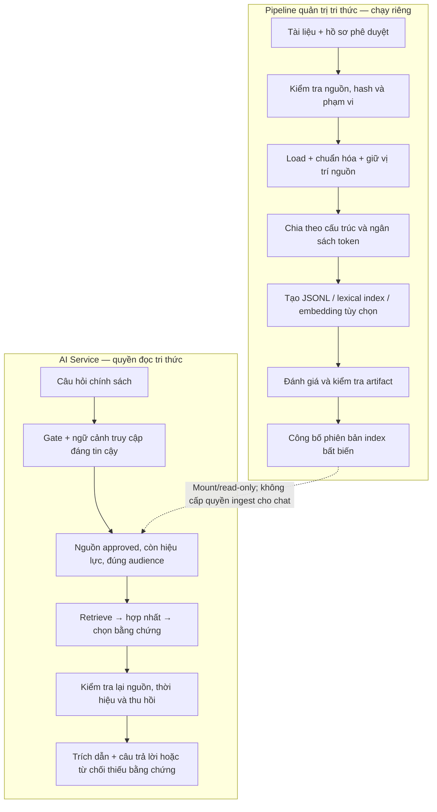

# Kế hoạch bổ sung chunking và RAG cho SmartEvent AI Service

Ngày lập: 18/10/2026. Mã nguồn đối chiếu: `5cceeba` — foundation 0.1.2.

**Trạng thái: ĐÃ TRIỂN KHAI BASELINE 0.2.0.** Phần khảo sát bên dưới ghi hiện trạng tại commit 5cceeba trước triển khai. Các gate phục vụ corpus thật vẫn BLOCKED; tài liệu này không tự cấp quyền bật tính năng.

| Phần kế hoạch | Kết quả triển khai |
|---|---|
| 1 — Hợp đồng | Model/port, schema runtime và cấu hình mặc định tắt |
| 2 — Ingest/chunking | Markdown/TXT, tokenizer JSON pin hash, cấu trúc/overlap/bảng và provenance |
| 3 — Retrieval | BM25, lọc trước ranking, kiểm tra lại catalog, parent expansion và citation |
| 4 — Semantic benchmark | ONNX CPU E5 thật và so sánh dense/hybrid offline; chưa chọn semantic cho serving |
| 5 — Chat | REFUND_POLICY, APPROVED_CORPUS/citations và readiness riêng; default vẫn tắt |
| 6 — Vận hành | CLI build/evaluate/publish, publication nguyên tử, kiểm thử và CI; generation là tùy chọn chưa triển khai |

Bằng chứng và giới hạn ở [RAG_QA_REPORT.md](RAG_QA_REPORT.md); hướng dẫn ở [RAG_OPERATIONS.md](RAG_OPERATIONS.md).

## 1. Kết luận từ codebase hiện tại

| Thành phần | Bằng chứng | Hiện trạng |
| :--- | :--- | :--- |
| Chia dữ liệu train/validation/test | `src/smartevent_ai/tooling/dataset_split.py` | Đã có; chia mẫu theo nhóm hội thoại/họ kịch bản, không chia nội dung tài liệu thành chunk |
| Khai báo `retrieve_policy` | `configs/runtime_tool_registry.yaml`, mục `pure_operations` | Chỉ là khai báo; không phải implementation retrieval hoặc business HTTP tool |
| Trả lời chính sách | `application/response_composer.py`, nhánh `REFUND_POLICY` | Câu trả lời giới hạn cố định, chưa đọc corpus |
| Điều phối RAG | `application/chat.py`, `application/ports.py`, `infrastructure/bootstrap.py` | Chưa có use case/port/adapter RAG; chỉ nối NLU baseline và business gateway |
| Loader, chunker, embedding, index, retriever, citation | Cây mã nguồn và dependency hiện có | Chưa triển khai |
| Quản trị nguồn | Đặc tả lịch sử `15_RAG_CORPUS_GOVERNANCE.md`, `rag_corpus_policy.yaml`, gate `RAG-APPROVED-CORPUS` | Đã có yêu cầu thiết kế; chưa có bằng chứng corpus chính sách được duyệt trong repository |

Hai ảnh tham khảo thể hiện đúng các công đoạn của RAG: loading → chunking → embedding/index → retrieval → trả lời có nguồn. Áp dụng các trách nhiệm này vào cấu trúc Clean Architecture đang có; giữ package `src/smartevent_ai`, entrypoint, API và business gateway hiện hành.

## 2. Phạm vi phiên bản đầu

- Tra cứu chính sách/FAQ công khai đã được chủ nội dung duyệt. Tích hợp chat ban đầu ở intent `REFUND_POLICY`; mở rộng intent sau khi có bộ đánh giá tương ứng.
- Nhận Markdown/TXT từ thư mục nguồn do pipeline quản trị cấu hình. PDF/HTML được bổ sung khi có nguồn thực tế và có kiểm tra chất lượng trích xuất.
- Cho phép phát triển/test bằng fixture tổng hợp ghi rõ `TEST_ONLY`; fixture không được xuất thành corpus production đã duyệt.
- Chưa dùng RAG để xác nhận đơn hàng, thanh toán, vé cá nhân, giá hoặc tồn kho. Các dữ kiện đó vẫn cần các business GET tool và gate riêng.
- Chưa đưa upload, crawl URL tùy ý, ingest, sửa index hay chọn audience vào API chat công khai.
- Không tự index toàn bộ `docs/`, README, audit, security runbook hoặc đặc tả v1.2 thành chính sách SmartEvent.

## 3. Kiến trúc đích



Ghi artifact/index thuộc pipeline tri thức riêng, không phải quyền ghi dữ liệu nghiệp vụ. Chatbot không được có port/credential để công bố, upsert, xóa hay thu hồi corpus. Business HTTP tiếp tục chỉ GET qua `SafeBackendTransport`; không mở rộng quyền của nó để gọi vector database.

## 4. Ánh xạ các thư mục trong ảnh

| Trách nhiệm trong ảnh | Vị trí phù hợp trong dự án |
| :--- | :--- |
| `config/` | `configs/` và `infrastructure/`; YAML/Pydantic không đi vào domain |
| `ingestion/`, `loaders/` | Loader ở adapter; CLI và công việc ghi artifact ở `tooling/offline_jobs/` |
| `chunking/`, `splitters/` | Policy/bất biến ở domain, điều phối ở application, tokenizer/splitter thư viện ở adapter |
| `embeddings/` | Port của application; implementation ở `adapters/outbound/knowledge/` |
| `vectordb/`, `vectorstore/` | Adapter đọc index ở runtime; writer nằm trong pipeline offline |
| `retrieval/`, `chains/` | Use case RAG trong application, retriever thực thi port ở adapter |
| `prompts/`, `llm/` | Adapter tạo câu trả lời; model không được tự gọi tool hoặc thay đổi gate |
| `api/` | Mở rộng DTO/endpoint hiện hữu ở `adapters/inbound/http_api.py` |
| `tests/`, `logs/` | Test theo từng lớp; log vận hành không chứa corpus/query nhạy cảm và không commit log vào Git |

Cây tệp dự kiến; tên có thể tinh chỉnh trong PR đầu, giữ nguyên ranh giới phụ thuộc:

```text
src/smartevent_ai/
├── domain/knowledge.py                    # PolicyDocument, Chunk, Citation, Evidence
├── application/
│   ├── knowledge_ports.py                # Các Protocol cho loader/tokenizer/index/clock
│   ├── ingest_knowledge.py               # Use case ingest, chỉ CLI gọi
│   └── retrieve_policy.py                # Use case truy xuất và chọn bằng chứng
├── adapters/outbound/knowledge/
│   ├── document_loader.py                # Markdown/TXT; thêm PDF/HTML theo nhu cầu
│   ├── structure_chunker.py              # Cấu trúc tài liệu + bộ đếm token thật
│   ├── lexical_reader.py                 # Baseline tìm kiếm lexical
│   ├── embedding_adapter.py              # Tùy chọn, sau benchmark
│   ├── vector_reader.py                  # Tùy chọn, chỉ đọc khi runtime
│   └── answer_adapter.py                 # Trích đoạn; generation là bước sau
├── infrastructure/knowledge_config.py     # Đọc/validate cấu hình và wiring
└── tooling/offline_jobs/
    ├── build_index.py                    # CLI ingest/build, không expose qua HTTP
    └── evaluate.py                       # Đánh giá corpus/retrieval/citation
configs/
├── rag.yaml                              # Mặc định disabled; giới hạn và profile
└── schemas/
    ├── rag_source.schema.json            # Hợp đồng runtime chặt hơn bản lịch sử
    └── rag_evaluation.schema.json
tests/
├── fixtures/rag/                          # Nguồn và câu hỏi tổng hợp TEST_ONLY
├── test_knowledge_contracts.py
├── test_knowledge_chunking.py
├── test_knowledge_ingestion.py
├── test_policy_retrieval.py
└── test_policy_chat.py
```

Không tạo thư mục rỗng hoặc skeleton cho provider chưa dùng. `domain` vẫn chỉ dùng standard library; application chỉ dùng domain/port. Các thư viện LangChain, tokenizer, PDF parser, embedding và vector client thuộc adapter/tooling.

## 5. Hợp đồng nguồn và chunking

### Nguồn được phép

- Manifest phải có source ID, version, canonical URI, owner/reviewer, hồ sơ phê duyệt có thể xác minh, audience, locale, hash và thời điểm hiệu lực có timezone. Cờ `approved` tự khai không đủ.
- Validate riêng schema và quy tắc nghiệp vụ: hash khớp byte nguồn; khoảng thời gian hợp lệ; thời gian phê duyệt phù hợp; không dùng draft/revoked/superseded/expired hoặc nguồn quá hạn review theo chính sách đã duyệt.
- Runtime MVP chỉ phục vụ `customer_public`. Client/state/model không được nâng audience thành `customer_authenticated` hoặc `staff_internal`.
- Tách hash byte gốc khỏi hash nội dung đã chuẩn hóa. Giữ ánh xạ section/trang/offset để đối chiếu citation với nguồn.
- Loader giới hạn kích thước/số trang/thời gian; chỉ đọc dưới corpus root đã cấu hình, chặn path traversal và symlink thoát root. PDF không trích xuất đủ chất lượng phải bị từ chối hoặc đưa vào quy trình OCR được review.

### Chính sách chia chunk đề xuất

1. Tách theo heading → điều khoản/đoạn → câu; tách đệ quy phần quá dài. Giữ liên kết giữa quy tắc, điều kiện và ngoại lệ; không gộp khác tài liệu/version/audience.
2. Bảo toàn dấu tiếng Việt, số tiền, ngày, từ phủ định, danh sách và cấu trúc bảng. Với bảng quá lớn, chia theo hàng và lặp tiêu đề; giữ tham chiếu phần cha.
3. **Profile thử nghiệm ban đầu:** tối đa 384 token cho đầu vào embedding, overlap mục tiêu tối đa 64 token trong cùng section. Thử thêm 256/512 token và overlap 0/32/64 để chọn bằng đánh giá, không gọi một cấu hình là tối ưu trước benchmark.
4. Đếm bằng tokenizer đã pin của embedding model, tính cả prefix/title/heading/special tokens. Không dùng số ký tự, số từ hoặc tokenizer của model khác để giả định giới hạn token.
5. Khống chế số chunk và tổng dung lượng mỗi tài liệu/corpus. Không cắt âm thầm nội dung vượt giới hạn; báo lỗi hoặc trạng thái chưa đủ điều kiện.
6. Metadata tối thiểu: `source_id`, `source_version`, `source_sha256`, `normalized_sha256`, `chunk_id`, `chunk_sha256`, `title`, `heading_path`, `page/offset` nếu có, `audience`, `locale`, thời hiệu, chunker/config/tokenizer revision.
7. ID xác định từ định danh nguồn, các hash, revision chunker/tokenizer, cấu hình, vị trí và nội dung. Cùng input/revision/config sinh cùng tập chunk và hash; không đưa timestamp chạy vào ID.

Tài liệu [LangChain về recursive splitting](https://docs.langchain.com/oss/python/integrations/splitters/recursive_text_splitter) mô tả tách theo separator và đo bằng `length_function`; ví dụ mặc định đo ký tự. [Hướng dẫn token splitting](https://docs.langchain.com/oss/python/integrations/splitters/split_by_token) yêu cầu đếm theo tokenizer phù hợp. Các con số trên là giả thuyết thử nghiệm cho SmartEvent, không phải khuyến nghị mặc định từ nguồn này.

## 6. Retrieval, index và câu trả lời

- **Baseline trước:** lexical/BM25 trên artifact local có version, không cần business DB, LLM hay vector server để chứng minh pipeline hoạt động. Lexical reader chỉ được tìm trong tập chunk đủ quyền và còn hiệu lực.
- **Dense/hybrid sau:** thử adapter embedding đa ngôn ngữ và hợp nhất kết quả lexical/dense; reranker chỉ thêm nếu cải thiện chất lượng đủ bù latency/tài nguyên. `BAAI/bge-m3` là một ứng viên benchmark, không phải lựa chọn mặc định đã được duyệt. [Model card chính thức](https://huggingface.co/BAAI/bge-m3) nêu hỗ trợ đa ngôn ngữ và nhiều chế độ retrieval; vẫn phải đánh giá riêng với tiếng Việt và phần cứng dự án.
- **Vector store:** MVP chưa cần quyết định FAISS/Qdrant. Khi cần service có lưu trữ và filter metadata, đánh giá Qdrant như adapter tùy chọn; [tài liệu chính thức](https://qdrant.tech/documentation/search/filtering/) mô tả filter payload. Không coi filter database là bằng chứng duy nhất về quyền truy cập.
- Filter trước khi xếp hạng/top-k/rerank: approved, audience do server xác định, locale, scope và thời hiệu `effective_from <= now < effective_until` nếu có ngày hết hạn. Không retrieve toàn corpus rồi mới loại nội dung không được phép.
- Kiểm tra lại bằng catalog nguồn/thu hồi đáng tin cậy trước khi trả lời. Thiếu catalog, catalog không đủ tươi, lỗi integrity hoặc xung đột version chưa có quy tắc phân giải phải trả thiếu bằng chứng. Không để cache hoặc rollback hồi sinh nguồn đã bị thu hồi.
- Build release index bất biến ở staging, kiểm chứng rồi chuyển phiên bản đang phục vụ nguyên tử. Manifest ghi source/chunk/index hashes, commit, config, model/tokenizer revision, dimension, normalize/prefix và kết quả evaluation. Runtime mount chỉ đọc.
- Cache embedding theo nội dung và profile model đầy đủ; vẫn giữ metadata/quyền riêng của từng chunk. Đổi model/revision/dimension/profile phải tạo index release mới.
- **Câu trả lời đầu tiên dùng trích đoạn xác minh được**, không chờ fine-tune hoặc LLM. Citation gồm source ID, version, chunk ID, section/trang và URI canonical đã duyệt; không bịa URL.
- Khi thêm generation, dùng port riêng, giới hạn ngân sách context theo tokenizer của model trả lời, dành chỗ cho system/query/output. Chỉ đưa bằng chứng đã lọc; coi nội dung chunk là dữ liệu không đáng tin cậy, không phải lệnh đổi policy hoặc gọi tool.
- Kiểm tra citation trỏ đúng bằng chứng đã retrieve. Không đủ nguồn, có mâu thuẫn hoặc không thể bảo đảm câu trả lời được nguồn hỗ trợ thì abstain/hỏi làm rõ. Model/JEV không có quyền tự bật gate.

## 7. Thứ tự chỉnh sửa theo từng PR

| PR | Phạm vi | Tệp/chạm chính | Điều kiện hoàn thành |
| :--- | :--- | :--- | :--- |
| 1 — Hợp đồng RAG | ADR đề xuất, source/chunk/citation models, các port, config disabled, schema runtime | `domain/knowledge.py`, `application/knowledge_ports.py`, `configs/rag.yaml`, schemas, resource fallback, settings/bootstrap | Domain/application không import thư viện ngoài; negative tests cho manifest/quyền/thời hiệu; default vẫn tắt |
| 2 — Ingest và chunking | Loader Markdown/TXT, chuẩn hóa, chia cấu trúc/token, CLI xuất chunks JSONL + build manifest | Loader/chunker adapter, `application/ingest_knowledge.py`, `tooling/offline_jobs/build_index.py`, fixtures | Có demo offline chia tài liệu dài; chunk có provenance; kiểm tra ranh giới token bằng tokenizer pin; hash tái lập Windows/Linux; không mất điều kiện/ngoại lệ |
| 3 — Retrieval baseline | Index lexical, filter trước retrieval, kiểm tra catalog/thu hồi, citation, đánh giá offline | `lexical_reader.py`, `application/retrieve_policy.py`, evaluator và bộ câu hỏi riêng | Truy xuất được fixture có nguồn; không leak audience/nguồn thu hồi/hết hạn; no-evidence và conflict trả fallback; chưa nối public chat |
| 4 — Benchmark semantic | Thử embedding và dense/hybrid so với baseline; chỉ thêm vector service nếu có cơ sở | Adapter embedding/vector nếu được chọn, optional dependencies, lockfile, manifest profile | Có số liệu chất lượng/latency/RAM trên máy đích; pin weights/tokenizer/checksum; kiểm thử thật adapter được chọn; dependency audit không bỏ sót nhóm RAG |
| 5 — Tích hợp chat | Nhánh `REFUND_POLICY`, grounding/citations, readiness từng thành phần, cấu hình gate | `chat.py`, `models.py`, `dialogue.py`, `http_api.py`, `bootstrap.py`, response composer, tests | Default vẫn hành vi cũ; có gate/corpus hợp lệ mới trả nguồn; lỗi RAG fallback an toàn; không tác động business gateway hoặc quyền dữ liệu riêng tư |
| 6 — Generation và vận hành | Model trả lời nếu cần, injection/abstention eval, publish/rollback, CI/smoke và tài liệu | Adapter trả lời, pipeline offline, CI, Docker profile và release docs | Corpus thật được duyệt; integration/evaluation đạt gate; runtime không có writer; public exposure vẫn phải hoàn thành các gate bảo mật/hiệu năng còn lại |

PR 4 có thể hoãn sau PR 5 nếu baseline đạt yêu cầu trên corpus thật. Generation là tùy chọn sau retrieval có nguồn; không phụ thuộc bắt buộc vào QLoRA hoặc JEV. PR 1–3 có thể phát triển bằng fixture trong khi chờ chủ nội dung phê duyệt corpus thật.

## 8. Các điểm sửa bắt buộc trong codebase hiện hữu

- Giữ nguyên `dataset_split.py`; định nghĩa schema RAG evaluation riêng thay vì ép câu hỏi retrieval vào training schema ontology.
- `retrieve_policy` tiếp tục là knowledge operation, không thêm vào danh sách business HTTP tools. Khai báo hiện có không tự tạo quyền thực thi.
- Bổ sung grounding riêng, ví dụ `APPROVED_CORPUS`, và trường `citations` typed ở application/HTTP. Không gắn câu trả lời chính sách với `BACKEND_READ`; không nhận citation/audience/quyền từ client. Kiểm tra tương thích với consumer khi mở rộng enum/response.
- Readiness thể hiện từng thành phần: policy retrieval có thể sẵn sàng trong khi business tools vẫn tắt. Không đổi trạng thái business thành ready chỉ vì có RAG; định nghĩa rõ hợp đồng tổng thể và cập nhật test.
- Cập nhật `verify_runtime_config_sync.py`: hiện chỉ kiểm tra hai cặp YAML. Mọi config/schema runtime mới đóng gói phải được kiểm tra byte-identical, không chỉ copy thủ công.
- Khi có adapter knowledge dùng mạng, xác định origin/credential/query allowlist riêng. Nếu SDK dùng POST cho truy vấn đọc vector, phải ghi rõ ngoại lệ giới hạn trong ADR/static checks; không nới quy tắc GET của backend nghiệp vụ hoặc cho phép runtime có quyền ghi index.
- Runtime baseline không tải model, tạo index hay gọi mạng trong import/startup mặc định. Optional RAG dependencies được khóa và audit riêng; wheel smoke không yêu cầu GPU/model download.
- Artifact corpus/index/model weights/cache không đưa vào source manifest hay Git; cấu hình chỉ định đường dẫn được quản trị và mount read-only. Bổ sung ignore/export tests khi triển khai.

## 9. Bộ kiểm thử và tiêu chí nghiệm thu

**Chunking:** tiếng Việt NFC/NFD, heading lồng nhau, văn bản dài không dấu câu, câu phủ định/ngoại lệ, bảng, tài liệu rỗng, overlap, token prefix, giới hạn dung lượng, ID ổn định, provenance đúng, không trộn source/version/audience.

**Governance:** manifest thiếu/hỏng, hash sai, tự khai approved, draft, future-effective, expired, revoked, superseded, review quá hạn, khoảng thời gian sai, version mâu thuẫn, symlink/path traversal, parser lỗi. Dùng clock được inject để test chính xác tại biên thời hiệu.

**Retrieval/chat:** filter trước ranking; giả mạo audience trong request/state; cache cũ sau revocation; lỗi catalog/vector/model; citation giả; nguồn không có URI HTTP; injection trong tài liệu; câu hỏi đơn hàng/tồn kho không bị trả lời bằng chính sách; không có bất kỳ business write hay index write từ chat.

**Chất lượng:** tạo tập câu hỏi tiếng Việt được owner gán nguồn/điều khoản chuẩn, có paraphrase, không dấu, không đủ bằng chứng, sai phạm vi, xung đột và câu hỏi độc hại. Tách dev/test theo nhóm paraphrase/kịch bản; không tune trên test. Tài liệu đích vẫn phải nằm trong snapshot corpus được phép truy xuất: đánh giá RAG không đồng nghĩa loại mọi tài liệu chứa đáp án khỏi index.

Đo Recall@k, MRR/nDCG, mức đủ bằng chứng của bộ chunk, tính hợp lệ/độ hỗ trợ của citation, precision/recall từ chối, latency p50/p95, RAM, thời gian ingest và kích thước index. **Ngưỡng khởi điểm đề xuất để owner/QA chốt trước benchmark:** Recall@5 ≥ 0,90; citation tham chiếu hợp lệ 100%; không leak nguồn bị cấm và không có ghi ngoài quyền trong toàn bộ bộ test bắt buộc. Đây là mục tiêu, chưa phải kết quả; SLO latency phụ thuộc phần cứng và được chốt sau đo baseline.

Giữ các gate hiện có: compile, static guard, Ruff/format, Mypy, coverage ≥ 90%, historical integrity, config sync, lock integrity/audit, source manifest, clean-wheel smoke và Docker. Các integration test với model/vector thật được ghi riêng; fake/unit test không thay thế bằng chứng này hoặc phê duyệt corpus.

## 10. Đầu vào cần có trước khi mở RAG thật

1. Bộ chính sách/FAQ canonical được chủ nội dung và reviewer được ủy quyền phê duyệt, có version, audience, thời hiệu và quy trình thu hồi.
2. Phần cứng mục tiêu, yêu cầu latency/tài nguyên và chính sách xử lý dữ liệu để chọn embedding/model/index phù hợp.
3. Bộ câu hỏi có đáp án/nguồn chuẩn và tiêu chí chấp nhận được chốt trước khi đo.

Thiếu các đầu vào này vẫn có thể hoàn thành nền tảng ingest/chunking/retrieval offline. Không chuyển gate `RAG-APPROVED-CORPUS` thành `PASS` hoặc bật public retrieval dựa riêng vào fixture, kế hoạch hay unit test.
