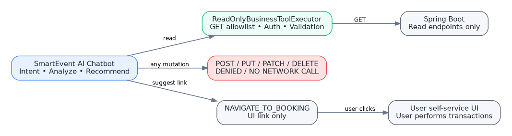
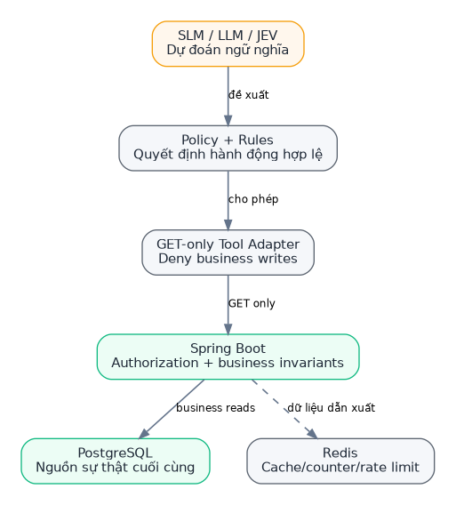
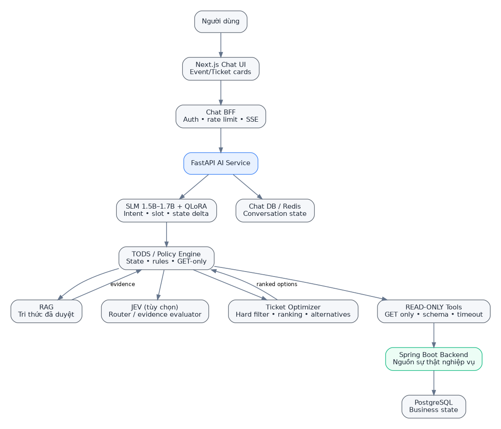
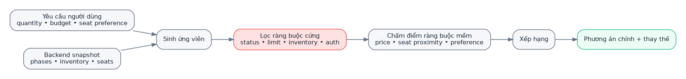
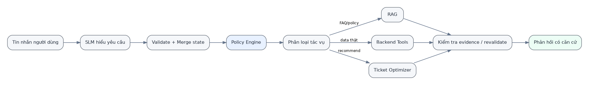
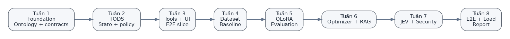
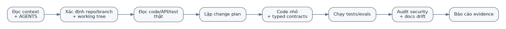

# Tóm tắt điều hành và quyết định cuối cùng

**QUYẾT ĐỊNH BẮT BUỘC — READ_ONLY:** AI Chatbot chỉ được tìm kiếm, đọc, phân tích, tổng hợp, giải thích, đề xuất và cung cấp liên kết điều hướng. AI **không được tạo, sửa, xóa, giữ chỗ, khởi tạo đơn, xử lý thanh toán, hoàn tiền hoặc gây bất kỳ thay đổi dữ liệu nghiệp vụ nào** trong mọi phiên bản V1/V2/V3. Các tài liệu trước đây cho phép AI tạo reservation/refund-review đã bị thay thế.

**Mô hình mục tiêu:** Next.js Chat UI + Chat BFF + FastAPI/TODS + SLM Qwen3-1.7B/QLoRA thử nghiệm + RAG + JEV tùy chọn + Ticket Optimizer + GET-only Spring Boot adapter.

**Phân biệt:** Coding Agent có quyền sửa mã nguồn khi được người quản lý giao; AI Chatbot khi vận hành chỉ đọc business data. Dialogue state và cache thuộc namespace riêng của AI, không tương đương dữ liệu nghiệp vụ.

**Trạng thái chặn phát hành:** Hợp đồng và reference harness đã có kiểm thử tĩnh/giả lập; private và event-child GET tools còn disabled đến khi backend/BFF/security gates đạt. Không coi đây là AI runtime đã triển khai.

**Trạng thái nghiên cứu:** QLoRA, JEV, hiệu năng, số liệu nghiệm thu là mục tiêu/đề xuất cần đo; không phải bằng chứng dự án đã triển khai. Repo `ai-service` vẫn được xem là trống tại snapshot đã khảo sát.



# Quy ước đọc và mức ưu tiên

1. `AGENTS.md` là nguồn luật ưu tiên cao nhất cho agent; tiếp theo là mục 13 (READ_ONLY contract), rồi policy/tool registry, sau đó tài liệu kiến trúc và nghiệp vụ.
2. Mã nguồn hiện tại dùng để xác định API và trạng thái thực tế; không dùng hiện trạng backend có mutation để suy ra AI được phép gọi.
3. Luật READ_ONLY thay thế tất cả mô tả cũ cho phép AI thao tác ghi, bao gồm phiên bản PRD 1.2 và Context Pack 1.0.
4. Bản Word/PDF giúp nhóm đọc. ZIP Markdown/YAML/JSON là nguồn máy đọc để Coding/Audit Agent làm việc.


# Luật nền tảng dành cho AI Agent

# AGENTS.md — SmartEvent AI Chatbot | READ-ONLY BUSINESS DATA

**Phiên bản 1.2 — 18/10/2026 — READ_ONLY + SAFE DATA PROJECTION + CUSTOMER SELF ONLY**

> **LUẬT CAO NHẤT:** SmartEvent AI Chatbot chỉ được **đọc, tìm kiếm, tổng hợp, giải thích, phân tích và đề xuất** dựa trên dữ liệu có quyền truy cập. AI Chatbot và bất kỳ tool/worker nào do chatbot kích hoạt **không được tạo, sửa, xóa, giữ chỗ, gửi yêu cầu, đặt hàng, chuyển vé, tạo thanh toán, hoàn tiền hoặc thay đổi trạng thái nghiệp vụ**. Mọi yêu cầu ghi dữ liệu phải chuyển người dùng sang giao diện nghiệp vụ có sẵn để **người dùng tự thao tác**; AI không âm thầm thực hiện thay.

Phạm vi lệnh cấm: **toàn bộ các phiên bản V1/V2/V3** cho đến khi có thay đổi quyết định được chủ dự án phê duyệt bằng tài liệu mới; không được suy diễn quyền ghi từ các tài liệu cũ hoặc tính năng backend đã tồn tại.

## 1. Phân biệt hai loại AI Agent

- **Chatbot runtime / AI Service / SLM / LLM / JEV / RAG / Tool Executor:** ràng buộc **READ_ONLY** đối với toàn bộ dữ liệu và hành động nghiệp vụ SmartEvent.
- **Coding Agent / Audit Agent** được giao phát triển dự án: được thay đổi **mã nguồn, tài liệu và test trong nhánh phát triển** theo yêu cầu chủ dự án; không được sử dụng quyền của chatbot để sửa dữ liệu nghiệp vụ thật. Khi kiểm thử chức năng ghi ở backend hiện có, chỉ dùng sandbox/test fixtures tách biệt với dữ liệu thật.
- Trạng thái hội thoại do hệ thống chat sở hữu (`conversation_id`, `state_delta`, lựa chọn UI, cache ngắn hạn) có thể được duy trì theo chính sách riêng để vận hành hội thoại. Đây **không phải** quyền ghi vào event/ticket/order/payment hay bất kỳ bảng nghiệp vụ nào. Nếu phải lưu thông tin hội thoại, tuân thủ chính sách retention/privacy và tách biệt quyền kết nối.

## 2. Kiến trúc cố định

`Next.js Chat UI → Chat BFF → FastAPI AI Service → TODS + SLM (QLoRA thử nghiệm) + RAG + JEV tùy chọn + Ticket Optimizer → READ-ONLY Tool Registry → Spring Boot GET APIs`.

- Spring Boot/PostgreSQL là nguồn sự thật cho event, ticket type, sale phase, inventory, seat, reservation, order, payment, ticket, refund-review.
- Model không tự sinh dữ kiện giá/tồn kho, không tính toán thay backend, không truy cập business DB trực tiếp.
- Ticket Optimizer **chỉ xếp hạng các lựa chọn**; không tạo giữ chỗ.
- RAG trả lời chính sách từ corpus đã duyệt; không tra payment/order bằng RAG.
- JEV chỉ phân loại và đánh giá bằng chứng, tùy chọn, có fallback.
- Mọi đầu ra hành động là **nút điều hướng/khuyến nghị UI**, không phải yêu cầu giao dịch.

## 3. Các bất biến READ_ONLY — vi phạm là P0

1. Tool Registry của chatbot **không có** `POST`, `PUT`, `PATCH`, `DELETE` hay lệnh tác động trạng thái nghiệp vụ. `POST /api/chat` là phương tiện gửi câu hỏi tới chính AI Service, **không phải** tool nghiệp vụ và không cấp quyền ghi.
2. Không cho phép tên tool như `create_reservation`, `request_refund_review`, `create_order`, `cancel_reservation`, `create_payment_url`, `transfer_ticket`, `refresh_qr`, `approve_refund` hoặc wrapper/alias dẫn tới nghiệp vụ tương tự; **không giữ dưới dạng 'disabled trong V1'**.
3. `prepare_checkout` nếu được nhắc trong tài liệu cũ **không phải tool**: thay bằng `NAVIGATE_TO_BOOKING` — chỉ trả `route` nội bộ cho frontend, tối đa gợi ý `eventId`, `ticketTypeId`, `salePhaseId`, `quantity` làm UI prefill theo hợp đồng hiện có. Không gọi API giữ chỗ và không mở `/checkout` khi chưa có `reservationId` từ luồng giao diện chính.
4. Không cho phép chuyển thao tác nghiệp vụ thành background job, webhook, event, SQL, batch, workflow hoặc gọi API gián tiếp.
5. Tool Executor phải allowlist **(GET + path tĩnh đã kiểm chứng + schema validate)**, từ chối mọi method khác và dùng credential backend tối thiểu quyền read-only. GET có side-effect phải được loại trừ khi phát hiện.
6. Với API riêng tư: credential được xác thực, Spring Boot kiểm tra ownership; không tin role, userId hoặc orderId do model tự khai.
7. Không sử dụng API không được backend kiểm tra phạm vi công khai để tiết lộ dữ liệu event chưa xuất bản; phải bổ sung guard backend hoặc adapter filter đã chứng minh đủ.
8. Chỉ hiển thị snapshot tồn kho/ghế với thời gian cập nhật; không bảo đảm còn chỗ tới lúc người dùng đặt vé. Không tuyên bố 'đã giữ/đã mua/đã thanh toán' nếu chưa có chứng cứ GET từ backend.
9. Các câu 'giữ vé giúp', 'hủy đơn giúp', 'hoàn tiền cho tôi' phải dẫn tới **giải thích giới hạn + điều hướng trang nghiệp vụ**, tuyệt đối không thao tác thay.
10. Không đưa token, QR credential, password, thông tin thanh toán nhạy cảm, PII chưa được phép vào prompt, dữ liệu huấn luyện hoặc log.
11. Mọi cấu hình tool/ontology/action/schema/evaluation phải nhất quán với `READ_ONLY`.

## 4. Thứ tự nguồn sự thật

**Quyền hạn và phạm vi sản phẩm:** AGENTS.md v1.2 → `13_READ_ONLY_BOUNDARY_AND_MIGRATION.md` → configs v1.2 → docs 01–12. **Các tài liệu PRD v1.2 / Context Pack v1.0 bị thay thế ở những phần cho phép mutation.** Không chọn quyền ghi dựa trên bản cũ.

**Hiện trạng backend/frontend:** code ở commit/branch đang làm → Flyway/tests → OpenAPI hiện có → ADR hiện hành → README → tài liệu cũ. Phải xác minh mã và hợp đồng cụ thể trước khi tích hợp.

## 5. Các điều kiện bảo mật v1.2 (P1 BẮT BUỘC)

- `GET` không đồng nghĩa an toàn: `/api/v1/payments/vnpay/ipn` là GET có side effect và **không có trong allowlist**.
- Trả lời từ GET không được chuyển raw DTO vào model/JEV/log. Bắt buộc allowlist projection, loại QR `qrCodeBase64`, `ticketCode`, secrets, PII/owner IDs, `paymentUrl`.
- Quyền private chatbot chỉ `CUSTOMER_SELF_ONLY`; không chuyển elevated role ADMIN/service, không sử dụng userId do model khai.
- Chỉ bật tool sau gate có test: public PUBLISHED guard, child visibility, private auth ownership, safe tickets projection, runtime zero-write.
- JSONL theo schema `dataset_contract=1.2`; chỉ flat ontology slots. RAG corpus phải approved/effective, chưa đủ nguồn thì không bịa.
- Xem tài liệu `14_TOOL_RUNTIME_CONTRACT_AND_SECURITY_GATES.md`, `15_RAG_CORPUS_GOVERNANCE.md`, `16_REPRODUCIBILITY_EVALUATION_MANIFEST.md` và `17_REPOSITORY_SOURCE_SNAPSHOT.md`; đồng thời đọc `configs/implementation_gates.yaml`, `configs/auth_delegation_contract.yaml`, `configs/rag_corpus_policy.yaml`.
- Đây là **hợp đồng tài liệu/kiểm thử tham chiếu**, chưa có bằng chứng AI Service runtime đã triển khai. Trạng thái release phải `BLOCKED` cho tới khi integration gates pass.

## 6. Giao thức coding/audit agent

1. Đọc `README_FIRST.md`, `AGENTS.md`, `13_READ_ONLY_BOUNDARY_AND_MIGRATION.md` và file chuyên đề.
2. Xem repo, branch, commit, `git status`; không ghi đè thay đổi chưa hiểu.
3. Lập plan, liệt kê file liên quan, policy/contract, migration và kiểm thử.
4. Không thêm tool nghiệp vụ ghi ở bất kỳ giai đoạn nào. Test chặn mọi phương thức khác GET ở Tool Executor (ngoại trừ transport nội bộ `/chat`).
5. Chạy lint, typecheck, unit, integration, security/evaluation liên quan; với frontend chạy `npm run check`.
6. Khi thấy xung đột, ưu tiên `READ_ONLY`, tạo finding và chỉnh lại cùng PR.
7. Báo cáo rõ thay đổi, bằng chứng, test, rủi ro và các vấn đề còn mở; không tuyên bố production-ready/merge-ready khi chưa chạy gate.

**Lưu ý repo:** `ai-service` là repo trống tại thời điểm khảo sát; chưa có AI production. `smartevent-web/AGENTS.md` cũng phải được đọc trước khi sửa Next.js; file đó chứa quy tắc version-specific.


# 00 - Bản đồ tài liệu AI Agent

## Mục tiêu

**QUYẾT ĐỊNH MỚI v1.2:** Chatbot chỉ READ/ANALYZE/RECOMMEND, không được tạo/sửa/xóa dữ liệu nghiệp vụ. Xem `13_READ_ONLY_BOUNDARY_AND_MIGRATION.md`.

Bộ tài liệu này biến ngữ cảnh hội thoại thiết kế thành một đặc tả có thể kiểm tra, để AI Agent không phải suy luận lại kiến trúc từ đầu.

## Bản đồ nhanh

| Tài liệu | Trả lời câu hỏi |
|---|---|
| 01 Project Context | Dự án đang giải quyết bài toán gì? Phạm vi V1/V2? |
| 02 Current Architecture | SmartEvent hiện có gì? Module, stack, API, source of truth? |
| 03 Target AI Architecture | AI Service phải được xây như thế nào? |
| 04 Business Flows | Luồng nghiệp vụ và state machine nào phải giữ đúng? |
| 05 Dialogue Ontology | Chatbot hiểu intent/slot/state/action như thế nào? |
| 06 Data/Fine-tuning/RAG/JEV | Dữ liệu huấn luyện và retrieval được tổ chức ra sao? |
| 07 Tool/API Contracts | Model được gọi những tool nào và map vào API nào? |
| 08 Security Rulebook | Những luật nào là bất biến an toàn? |
| 09 Implementation Plan | Làm theo thứ tự nào trong 8 tuần? |
| 10 Test/Evaluation | Đo chất lượng và nghiệm thu thế nào? |
| 11 Agent Protocol | AI coding/audit agent phải làm việc ra sao? |
| 12 Decisions/Open Questions | Những gì đã chốt và những gì chưa chốt? |
| 13 Read-Only Boundary | Quyền đọc tuyệt đối, cấm gọi mutation và cách sửa từ v1.0. |

## Từ vựng chuẩn

- **Trợ lý hội thoại hướng tác vụ (Task-Oriented Dialogue System - TODS):** hệ thống theo dõi trạng thái và giúp người dùng hoàn thành mục tiêu nhiều bước.
- **Mô hình ngôn ngữ nhỏ (Small Language Model - SLM):** mô hình 1-2B tham số được dùng cho tác vụ hẹp, có cấu trúc.
- **Tinh chỉnh hạng thấp (Low-Rank Adaptation - LoRA/QLoRA):** kỹ thuật chỉ huấn luyện adapter thay vì toàn bộ trọng số.
- **Truy xuất tăng cường (Retrieval-Augmented Generation - RAG):** tìm tài liệu có căn cứ trước khi tạo câu trả lời.
- **Bộ đánh giá JEV:** thành phần quyết định có cấu trúc, tùy chọn, dùng cho routing/evidence scoring.
- **Bộ tối ưu vé (Ticket Optimizer):** code xác định trước để lọc hard constraints và xếp hạng soft constraints.
- **Công cụ nghiệp vụ (Business Tool):** adapter cho API backend được allowlist.
- **Thay đổi trạng thái (State Delta):** phần thay đổi của dialogue state ở lượt hiện tại, thay vì model sinh lại toàn bộ state.

## Cập nhật v1.2 — đọc ngay sau AGENTS

- [14 Tool Runtime Contract](14_TOOL_RUNTIME_CONTRACT_AND_SECURITY_GATES.md): typed inputs/outputs, raw QR filtering, customer-self-only, published-only, gates.
- [15 RAG Corpus Governance](15_RAG_CORPUS_GOVERNANCE.md): chỉ ingest chính sách approved và có hiệu lực.
- [16 Evaluation & Reproducibility](16_REPRODUCIBILITY_EVALUATION_MANIFEST.md): model/dataset/repo SHA, baseline/test.
- Các private tools và 5 child-event tools được giữ **disabled** đến khi gate đạt; không gọi chúng là năng lực đã triển khai trong V1.


# 01 - Bối cảnh, mục tiêu và phạm vi dự án

## 1. Bối cảnh

SmartEvent là nền tảng quản lý sự kiện và phân phối vé điện tử. Backend hiện đã giải quyết các luồng khó của hệ thống bán vé: sự kiện, phân khu/ghế, hạng vé và đợt mở bán, giữ chỗ có thời hạn, đơn hàng, thanh toán, phát hành vé, QR/check-in, hóa đơn, thông báo bất đồng bộ và hỗ trợ đối soát hoàn tiền.

Chatbot mới không được xây như một hệ thống bán vé song song. **Tại mọi phiên bản, AI chỉ đọc và phân tích; không tạo, sửa, xóa hoặc kích hoạt trạng thái nghiệp vụ.** Mục tiêu là tạo một **lớp tương tác thông minh phía trên hệ thống hiện có**.

## 2. Mục tiêu sản phẩm

SmartEvent AI Ticketing Copilot phải giúp khách hàng:

1. Diễn đạt nhu cầu bằng tiếng Việt tự nhiên.
2. Tìm sự kiện theo địa điểm, danh mục, thời gian và từ khóa.
3. Hiểu giá, đợt bán, hạng vé và tình trạng khả dụng.
4. Đưa ra phương án vé phù hợp theo số lượng, ngân sách và ưu tiên ghế.
5. Đề xuất phương án thay thế khi lựa chọn ban đầu không còn khả dụng.
6. Trả lời FAQ/chính sách bằng nguồn tài liệu đã phê duyệt.
7. Tra cứu dữ liệu cá nhân như order/payment/ticket khi đã xác thực.
8. Chỉ **điều hướng người dùng** tới màn hình chọn vé/đặt vé hiện hữu; người dùng tự thao tác, AI không giữ chỗ.
9. Chỉ **giải thích quy trình hoàn tiền** và hiển thị tình trạng hồ sơ hiện có (nếu được quyền); tuyệt đối không khởi tạo hồ sơ review.

## 3. Điểm mới kỹ thuật chính

Điểm mới không phải “dùng chatbot” hay “dùng RAG”. Trọng tâm là:

**Availability-Aware, Constraint-Aware Conversational Ticket Recommendation**.

Nghĩa là chatbot phải giữ được yêu cầu nhiều lượt, phân biệt hard/soft constraints, lấy dữ liệu tồn kho hiện thời, tối ưu phương án và xử lý stale data trước khi hiển thị hoặc chuyển người dùng sang màn hình giao dịch; chatbot không tiến hành giao dịch.

## 4. Phạm vi V1

### Bắt buộc

- Hội thoại tiếng Việt nhiều lượt.
- Intent + slot + state delta có cấu trúc.
- Tìm kiếm/chi tiết sự kiện.
- Tra cứu ticket type, sale phase, inventory, available seats.
- Ticket Optimizer.
- RAG cho FAQ/policy.
- Tra cứu my orders, payment status, my tickets sau auth.
- `NAVIGATE_TO_BOOKING`: trả gợi ý route nội bộ đến UI đặt vé hiện có; không phải tool và không tạo reservation.
- Logging/tracing tối thiểu, rate limit, validation, fallback.
- Bộ đánh giá chất lượng và dataset riêng.

### Có thể bật sau khi V1 ổn định

- JEV routing/evidence evaluator.
- Không có: khả năng chatbot tự tạo giữ chỗ, kể cả khi người dùng đồng ý. Đây là điều cấm toàn phiên bản.
- Model routing giữa SLM và LLM lớn.

## 5. Ngoài phạm vi V1

- Mọi thao tác ghi nghiệp vụ: tạo/hủy giữ chỗ, tạo đơn, thanh toán, gửi refund-review, chuyển/đổi vé, cập nhật hồ sơ.
- Autonomous payment.
- Automatic refund.
- Multi-agent architecture.
- Reinforcement learning cho dialogue policy.
- Voice-first assistant.
- Personalization dài hạn dựa trên behavioral profiling.
- Recommendation ML phức tạp dựa trên lịch sử click/mua.
- Kubernetes/high-availability production cluster.

## 6. Đối tượng người dùng

### Customer/Buyer - đối tượng chính V1

Use cases: khám phá sự kiện, chọn vé, hỗ trợ booking, order/payment/ticket support.

### Organizer/Admin

Chatbot nghiệp vụ cho organizer/admin **không thuộc V1**. Các quyền này vẫn dùng workspace hiện có. Không expose tool quản trị cho assistant customer.

## 7. Tiêu chí thành công sản phẩm

- Tỷ lệ hoàn thành tác vụ end-to-end >= 85% trên bộ kịch bản chuẩn.
- Không có cross-account leak trong test.
- Không có **bất kỳ AI-triggered business write nào** trong test; tool allowlist chỉ GET đã được kiểm chứng.
- Không có hard-constraint violation trong recommendation test.
- Không hallucinate giá/tồn kho/payment status khi thiếu backend evidence.
- Có benchmark chứng minh QLoRA hoặc JEV đáng được giữ nếu triển khai.


# 02 - Kiến trúc SmartEvent hiện tại




**Ranh giới AI v1.2:** các controller POST/PUT/PATCH/DELETE dưới đây thuộc chức năng SmartEvent do người dùng/frontend nghiệp vụ vận hành; chúng **không** phải tool cho AI Chatbot. Không nhầm mô tả backend với quyền thực thi AI.

## 1. Snapshot repository

Tại thời điểm 17/10/2026:

| Repository | Trạng thái / vai trò |
|---|---|
| `smartevent-backend` | Backend nghiệp vụ đang hoạt động; Java 17, Spring Boot 4.0.7, modular monolith |
| `smartevent-web` | Next.js 16.3.2, React 19.2.8, TypeScript, Tailwind 4, openapi-fetch |
| `smartevent-infra` | Docker Compose cho PostgreSQL 16, Redis 7, RabbitMQ 3, MinIO |
| `ai-service` | Repository trống; đây là nơi triển khai chatbot |

## 2. Kiến trúc backend

Backend là **modular monolith**. Các module chính trong `src/main/java/com/smartevent/modules/`:

- `identity`: user, role, JWT, refresh token.
- `event`: category, venue, event, area, seat, media.
- `ticketing`: ticket type, sale phase, inventory, quota/counter.
- `reservation`: giữ chỗ có thời hạn, giữ/nhả resource.
- `ordering`: order, order item, price snapshot.
- `payment`: payment, gateway callback/IPN, reconciliation/refund review.
- `ticket`: phát hành ticket, QR, transfer, check-in.
- `invoice`: invoice, PDF, delivery.
- `outbox`: transactional outbox và publisher worker.
- `notification`: consumer/gửi email.
- `storage`: MinIO object + metadata.

## 3. Source of truth và consistency

- PostgreSQL quyết định state nghiệp vụ.
- Redis chỉ cache/counter/rate-limit; không được dùng làm authority cuối cùng.
- RabbitMQ có semantics at-least-once; consumer phải idempotent.
- MinIO chứa object; PostgreSQL chứa metadata.
- Side effect ngoài DB không nằm trong cùng transaction nên dùng outbox/retry/reconciliation.

## 4. Các state enum quan trọng

### EventStatus
`DRAFT -> PENDING_APPROVAL -> PUBLISHED`, cùng `CANCELLED`, `COMPLETED`.

### SeatStatus
`AVAILABLE`, `HELD`, `SOLD`, `BLOCKED`.

### ReservationStatus
`PENDING`, `CONFIRMED`, `EXPIRED`, `CANCELLED`.

### OrderStatus
`PENDING_PAYMENT`, `PAID`, `CANCELLED`, `EXPIRED`, `PARTIALLY_REFUNDED`, `REFUNDED`.

### PaymentStatus
`INITIATED`, `PENDING`, `SUCCESS`, `FAILED`, `CANCELLED`, `REFUNDED`.

### TicketStatus
`ISSUED`, `USED`, `CANCELLED`, `REFUNDED`, `RESALE_LISTED`, `TRANSFERRED`.

### SalePhaseStatus
`DRAFT`, `SCHEDULED`, `ACTIVE`, `PAUSED`, `CLOSED`, `SOLD_OUT`.

### RefundReviewStatus
`REQUIRED`, `IN_REVIEW`, `REFUNDED_CONFIRMED`, `CLOSED_NO_REFUND`.

Lưu ý: RefundReview là **manual reconciliation state**; không có giá trị nào tự gọi provider refund.

## 5. Concurrency invariants

Agent phải giữ các bất biến sau:

1. Ghế chỉ được chuyển `AVAILABLE -> HELD` bằng thao tác nguyên tử/conditional update.
2. Reservation expiry và payment confirmation có thể chạy đua; chỉ một transition được thắng.
3. Check-in chỉ `ISSUED -> USED` một lần.
4. `affectedRows == 0` trong CAS có thể là business outcome bình thường.
5. Không thay các pattern này bằng read-then-write.

## 6. Frontend hiện tại

Các feature quan trọng:

- `src/features/catalog`: tìm kiếm và chi tiết sự kiện.
- `src/features/booking`: chọn hạng vé/ghế, active reservation, checkout.
- `src/features/orders`: order và refund review.
- `src/features/payments`: payment flow/result.
- `src/features/account`: ticket, invoice, transfer, QR.
- `src/features/auth`: session/login/register.

Client API dùng `openapi-fetch` và generated `src/lib/api/schema.d.ts`.

Access token được giữ phía client memory; refresh token là httpOnly cookie ở Next.js auth route. Vì vậy chatbot không được giả định BFF có thể suy ra user identity chỉ từ role cookie. Với tool riêng tư, authorization token phải được chuyển qua luồng đã xác minh và Spring Boot vẫn phải validate ownership.

## 7. Hạ tầng local

`smartevent-infra/docker-compose.yml` chạy:

- PostgreSQL 16.
- Redis 7.
- RabbitMQ management.
- MinIO.

Port mặc định bind `127.0.0.1`. Flyway trong backend là nguồn schema chuẩn.

## 8. Quality baseline hiện có

Backend đã có unit/service tests và Testcontainers cho một số phạm vi, nhưng tài liệu test-strategy lưu ý coverage hạ tầng/E2E/concurrency thật vẫn cần được mở rộng. Không dùng “số lượng test” để tuyên bố production-ready.

## 9. Nguồn code agent phải kiểm tra khi tích hợp AI

- `smartevent-backend/docs/01-architecture/system-architecture.md`
- `smartevent-backend/docs/01-architecture/architecture-decisions.md`
- `smartevent-backend/docs/01-architecture/critical-flows.md`
- `smartevent-backend/src/main/java/com/smartevent/config/SecurityConfig.java`
- Controllers/DTOs của event, ticketing, reservation, ordering, payment, ticket.
- `smartevent-web/src/lib/api/client.ts`
- API wrappers trong `src/features/*/api`.
- `smartevent-web/AGENTS.md` trước mọi thay đổi frontend.


# 03 - Kiến trúc AI mục tiêu




## 1. Kiến trúc chốt


*(Sơ đồ chi tiết có trong tệp Markdown gốc của gói cho AI Agent.)*


## 2. Nguyên tắc thiết kế

### Stateless service ở tầng compute

AI Service không giữ state quan trọng trong process memory. Conversation state có thể lưu qua repository abstraction ở **namespace chat do AI Service sở hữu**; Redis dùng cho state ngắn hạn/cache và PostgreSQL chat schema (nếu được phê duyệt) cho retention/audit. Quyền ghi chat state **không** được mở rộng sang database nghiệp vụ Spring Boot.

### Bộ cưỡng chế quyền đọc (bắt buộc)

- `ReadOnlyBusinessToolExecutor` chỉ chấp nhận tool có `method=GET`, endpoint đã đăng ký, schema đầu vào/đầu ra có kiểm tra.
- Không có `create_reservation`, `request_refund_review`, `create_order`, `payment`, `cancel`, `transfer` trong tool registry ở mọi giai đoạn.
- Các route như `/reservations/{eventId}` chỉ là **gợi ý navigation frontend**, không phải yêu cầu mutation hay xác nhận đã giữ chỗ.
- API riêng tư luôn đi qua cơ chế xác thực đã kiểm tra và quyền sở hữu backend.

### Hexagonal boundaries

- Domain: dialogue state, policy, constraints, optimizer.
- Application: orchestration/use-cases.
- Infrastructure: LLM, JEV, backend HTTP, database, Redis, retrieval.
- API: FastAPI route/schema/middleware.

Domain không import FastAPI/SQLAlchemy/httpx/SDK model provider.

## 3. Module đề xuất

```text
ai-service/
├── app/
│   ├── api/
│   ├── application/
│   ├── domain/
│   │   ├── dialogue/
│   │   ├── recommendation/
│   │   └── policies/
│   ├── models/
│   ├── rag/
│   ├── decisions/
│   ├── tools/
│   ├── integrations/
│   ├── persistence/
│   └── main.py
├── configs/
├── datasets/
├── training/
├── evaluations/
├── tests/
└── docs/
```

## 4. SLM role

Qwen3-1.7B + QLoRA chỉ chịu trách nhiệm tạo đầu ra có cấu trúc:

- `primary_intent`.
- `secondary_intents` nếu có.
- entities/slots phát hiện trong câu.
- `state_delta`.
- `proposed_action`.
- optional `ambiguities`.

SLM **không** trực tiếp quyết định transaction hoặc tạo dữ liệu event/ticket không có evidence.

## 5. Dialogue Manager/TODS

Nhiệm vụ:

- merge state delta bằng code xác định trước;
- kiểm tra required/conditional slots;
- resolve reference tới candidate đã hiển thị;
- chạy Policy Engine;
- enforce authentication/authorization;
- gọi tool thích hợp;
- xử lý tool result, stale data, retry/fallback;
- cập nhật conversation state.

## 6. RAG

RAG corpus gồm user-facing knowledge đã phê duyệt. Retrieval cần metadata:

- `source_id`;
- `title`;
- `version`;
- `effective_from/effective_to`;
- `access_level`;
- `document_type`.

Không index tài liệu nội bộ bảo mật vào public RAG corpus.

## 7. JEV

JEV triển khai qua abstraction:

```text
DecisionEvaluator
├── JevDecisionEvaluator
└── FallbackDecisionEvaluator
```

Vai trò cho phép:

- intent/router signal;
- đánh giá relevance/evidence của RAG;
- confidence signal.

Không dùng JEV cho arithmetic, payment truth, authorization hoặc hard business constraints.

## 8. Ticket Optimizer

Pipeline:

1. Candidate generation từ backend snapshot.
2. Hard constraint filtering.
3. Soft constraint scoring.
4. Ranking.
5. Alternative generation / constraint relaxation.
6. Đọc lại snapshot khi cần trước khi **khuyến nghị hoặc điều hướng**; không phát lệnh mutation.

Hard constraints không được nới:

- auth/ownership;
- event/sale status;
- purchase limit;
- available quantity;
- seat validity;
- reservation validity.

## 9. BFF và auth

Public tool có thể gọi không cần user token. Tool riêng tư phải có verified auth context.

Nguyên tắc:

- Browser không gửi provider API key.
- BFF không dùng role cookie làm bằng chứng quyền sở hữu object.
- Access token chỉ chuyển như credential transient tới layer cần thiết; không lưu trong conversation state/prompt/log.
- Backend Spring Security luôn là enforcement cuối cùng.

## 10. Observability tối thiểu

Mỗi chat request cần:

- `trace_id`/correlation ID;
- conversation ID;
- model route;
- tool names (không log secret/body nhạy cảm);
- latency theo stage;
- token/cost metrics khi provider cung cấp;
- policy decision;
- error category.


## Biểu diễn bộ tối ưu vé




# 04 — Luồng nghiệp vụ READ-ONLY và state machine




## 1. Quy tắc toàn cục

AI chỉ thực hiện `READ → ANALYZE → EXPLAIN → RECOMMEND → NAVIGATE`. Không có nhánh AI giữ chỗ/đặt hàng/chuyển vé/yêu cầu hoàn tiền. Trạng thái đặt vé/đơn hàng bên dưới là **trạng thái quan sát qua GET** chứ không do chatbot gây ra.

## 2. Luồng tìm kiếm và tư vấn vé


*(Sơ đồ chi tiết có trong tệp Markdown gốc của gói cho AI Agent.)*


- `NAVIGATE_TO_BOOKING` không gọi business API, không đặt ghế, không giữ số lượng, không khởi tạo đơn.
- Khi người dùng hỏi 'AI giữ vé giúp', phải nêu giới hạn quyền và dẫn tới `/reservations/{eventId}` (với `tier`, `phase`, `qty` nếu UI hỗ trợ). `/checkout?reservationId=...` **chỉ hợp lệ sau khi UI nghiệp vụ đã tạo reservation**.
- Sau khi chuyển trang, mọi cập nhật nghiệp vụ do người dùng thực hiện qua frontend/backend hiện tại, **không phải AI**.
- Kết quả inventory và seat là snapshot, có thể đổi bất kỳ lúc nào.

## 3. Ghế ngồi SEATED và khu đứng STANDING

- SEATED: GET area + seat statuses; ưu tiên mô tả ghế cùng hàng nếu đủ bằng chứng; `rowName/seatNumber` không tự động chứng minh gần nhau về hình học.
- STANDING: dùng hạng vé/đợt bán/số lượng; không bắt người dùng chọn `eventSeatId`.
- Vẽ sơ đồ ghế từ metadata có thực; không tự bịa tọa độ, đường đi hoặc cam kết ghế liền kề nếu backend chỉ có mã ghế.
- Không sinh payload `CreateReservationRequest` để gửi; nếu frontend có prefill thì frontend tự kiểm tra lại.

## 4. Tra cứu reservation/order/payment/ticket — CHỈ ĐỌC

- `get_active_reservation`, `get_reservation`: đọc trạng thái PENDING/CONFIRMED/EXPIRED/CANCELLED và `expiresAt` từ backend.
- `get_my_orders`, `get_order`: đọc order PENDING_PAYMENT/PAID/CANCELLED/EXPIRED/PARTIALLY_REFUNDED/REFUNDED; backend xác minh ownership.
- `get_payment_status`: đọc INITIATED/PENDING/SUCCESS/FAILED/CANCELLED/REFUNDED; tuyệt đối không suy luận payment SUCCESS đồng nghĩa có vé khi reservation đã hết hạn hoặc order bị hủy.
- `get_my_tickets`: đọc danh sách vé cá nhân qua token hợp lệ; không refresh QR, transfer, resend email, cancel ticket.
- Không tự tạo, cập nhật hoặc hủy bất kỳ đối tượng nào phía trên.

## 5. Hoàn tiền / hỗ trợ

- Có thể đọc `/api/v1/orders/{orderId}/refund-review` nếu xác thực là buyer chính chủ; trạng thái `REFUNDED_CONFIRMED` là kết quả đối soát thủ công, không phải chatbot đã thực hiện refund.
- Có thể RAG chính sách hoàn tiền đã được phê duyệt.
- **Không gọi `POST /refund-review`**, kể cả người dùng yêu cầu hoặc xác nhận. Chỉ chỉ dẫn người dùng mở tính năng hỗ trợ hoàn tiền tại trang tài khoản hoặc liên hệ kênh hỗ trợ được xác thực.
- `HUMAN_HANDOFF` là hướng dẫn/liên kết tới kênh hỗ trợ có sẵn; không tạo ticket support trong backend nếu việc đó phát sinh bản ghi.

## 6. Hội thoại nhiều lượt (state machine nội bộ)

```text
IDLE → UNDERSTANDING → COLLECTING_INFORMATION → READ_READY
  → FETCHING_READ_ONLY_DATA → ANALYZING → RECOMMENDING → ANSWERING
  → [WAITING_USER | NAVIGATION_SUGGESTED | COMPLETED]
```

Nhánh: `AUTH_REQUIRED`, `NO_RESULTS`, `STALE_SNAPSHOT`, `TOOL_UNAVAILABLE`, `OUT_OF_SCOPE`, `READ_ONLY_DENIAL`.

- `state_delta` cập nhật **state nội bộ cuộc hội thoại**, không liên quan state của reservation/order/payment.
- Không dùng `AWAITING_CONFIRMATION` cho nghiệp vụ ghi, `CREATE_RESERVATION`, `REFUND_SUBMITTED`, `ORDER_CREATED` làm trạng thái chatbot.
- Khi user sửa số lượng vé/ngân sách, cập nhật preference trong chat, **không chỉnh sửa giỏ hàng/đơn hàng backend**.

## 7. Ví dụ phản hồi bắt buộc

| Người dùng | Hành vi hợp lệ |
|---|---|
| 'Giữ giúp tôi 2 vé VIP' | Kiểm tra tồn kho bằng GET, giải thích chưa giữ vé và gợi ý nút 'Tự chọn vé'. |
| 'Hủy reservation này đi' | Đọc trạng thái nếu có auth, giải thích cách hủy trên giao diện; chatbot không gọi cancel. |
| 'Cho tôi hoàn tiền' | Đọc chính sách và hướng dẫn gửi yêu cầu ở giao diện tài khoản; không gửi POST. |
| 'Đổi 3 vé thành 2 vé' | Nếu đang tư vấn: chỉ cập nhật số lượng trong chat; nếu đã giữ chỗ: không sửa backend, hướng dẫn người dùng xử lý bằng UI. |
| 'Tôi đã thanh toán chưa?' | Chỉ đọc API auth + xác minh ID/ownership, phân biệt trạng thái payment và order. |

## 8. Xử lý stale snapshot

Mọi đề xuất là snapshot. Nếu người dùng quay lại lựa chọn: thực hiện GET mới nếu cần, cảnh báo khả dụng có thể đã thay đổi, điều hướng sang UI đã có kiểm tra cuối. Không có bước `revalidate → mutation` trong AI Service.


# 05 - Ontology hội thoại và chính sách điều phối

## 1. Intent V1

| Domain | Intent |
|---|---|
| General | GREETING, OUT_OF_SCOPE, CLARIFY |
| Event | SEARCH_EVENT, EVENT_DETAIL, EVENT_COMPARE |
| Ticket | TICKET_PRICE, TICKET_AVAILABILITY, SEAT_AVAILABILITY, TICKET_RECOMMEND, TICKET_ALTERNATIVE |
| Booking | BOOKING_GUIDANCE, RESERVATION_STATUS, CHECKOUT_HANDOFF |
| Account | ORDER_STATUS, PAYMENT_STATUS, MY_TICKETS |
| Support | REFUND_POLICY, REFUND_SUPPORT, TICKET_TRANSFER_HELP, HUMAN_HANDOFF |

Model có thể xuất `primary_intent` và `secondary_intents` để xử lý câu đa mục tiêu.

## 2. Slot chính

### Event
- `event_id`
- `event_name`
- `category_id/category_name`
- `city`
- `date_start/date_end`

### Ticket/booking
- `quantity`
- `ticket_type_id/ticket_type_name`
- `sale_phase_id`
- `preferred_area_id`
- `preferred_row`
- `seat_preference`

### Budget
- `amount`
- `currency`
- `scope`: `TOTAL`, `PER_TICKET`, `UNKNOWN`

### Account/reference
- `order_id`
- `order_code`
- `selected_candidate_id`
- `referenced_result_index`

## 3. State Delta operations

- `SET`: gán/thay giá trị.
- `REMOVE`: xóa một slot.
- `ADD`: thêm preference/exclusion.
- `CLEAR`: xóa một nhóm state.
- `REFER`: trỏ tới object/candidate đã hiển thị.
- `SWITCH_TASK`: chuyển active task.

Không để model viết lại toàn bộ state mỗi lượt. Công thức mục tiêu:

`S(t+1) = ValidateMerge(S(t), Delta(t))`.

## 4. Ví dụ correction

State cũ:

```json
{"city":"Hà Nội","quantity":2,"budget_amount":1200000,"budget_currency":"VND","budget_scope":"TOTAL"}
```

User: “Đổi thành ba vé nhưng giữ ngân sách.”

Delta chuẩn:

```json
{"state_delta":[{"operation":"SET","slot":"quantity","value":3}]}
```

Không lặp lại city/budget nếu không thay đổi.

## 5. Ambiguity policy

Hỏi lại khi mơ hồ **có ảnh hưởng materially tới hành động**.

Ví dụ “Tầm một triệu cho 2 người” có thể chưa rõ TOTAL hay PER_TICKET; hỏi lại trước tối ưu theo giá.

Không hỏi nếu có thể thực hiện một search rộng an toàn. Ví dụ “Có sự kiện âm nhạc cuối tuần này không?” không bắt buộc quantity.

## 6. Reference resolution

Câu “cái thứ hai”, “vé đó”, “sự kiện này” chỉ resolve khi conversation state có candidate mapping rõ ràng. Nếu reference có nhiều ứng viên, hỏi lại. Không để LLM chọn ngẫu nhiên.

## 7. Dialogue Policy

Policy có thứ tự kiểm tra:

**Đặc biệt:** `state_delta` chỉ sửa dữ liệu hội thoại của AI; không được gửi tới API ghi của SmartEvent. Chọn action có vẻ là POST/PUT/PATCH/DELETE phải bị policy map sang `EXPLAIN_WRITE_LIMITATION` hoặc `NAVIGATE_TO_BOOKING`.

1. Safety/system constraints.
2. Authentication/authorization requirements.
3. Quyền READ_ONLY — mọi yêu cầu mutation bị từ chối hoặc chuyển sang hướng dẫn UI.
4. Missing material information.
5. Valid state transition.
6. Tool GET-only availability/budget.
7. Optional model recommendation.

Model `proposed_action` chỉ là đề xuất; code Policy Engine quyết định action thực tế.

## 8. Proposed actions V1

- `ANSWER_GREETING`
- `ASK_CLARIFICATION`
- `SEARCH_EVENTS`
- `GET_EVENT_DETAILS`
- `GET_TICKET_OPTIONS`
- `CHECK_INVENTORY`
- `CHECK_SEATS`
- `RUN_TICKET_OPTIMIZER`
- `RETRIEVE_POLICY`
- `REQUEST_LOGIN`
- `GET_MY_ORDERS`
- `GET_PAYMENT_STATUS`
- `GET_MY_TICKETS`
- `NAVIGATE_TO_BOOKING` (điều hướng giao diện, không gọi backend tool)
- `EXPLAIN_WRITE_LIMITATION` (giải thích AI không thao tác thay người dùng)
- `SHOW_SUPPORT_CHANNEL` (chỉ hiển thị kênh/liên kết, không tạo ticket)
- `REFUSE_UNSUPPORTED_ACTION`

## 9. Conversation memory

Phân biệt:

- **Recent messages:** hội thoại gần nhất.
- **Dialogue state:** giá trị đang còn hiệu lực.
- **Candidate references:** object đã hiển thị để resolve pronoun/index.
- **Business state:** luôn nằm ở backend, không “nhớ” như fact lâu dài.
- **Long-term preference:** chưa bắt buộc V1; chỉ lưu khi có product/privacy decision riêng.

## v1.2 — Cấu trúc slot chuẩn và phân biệt decision/action

Canonical state, entities và state_delta sử dụng **flat slot names** khai báo trong `configs/dialogue_ontology.yaml`. Không sử dụng object lồng `budget` trong dữ liệu SFT. Chuyển `budget.amount → budget_amount`, `budget.scope → budget_scope`, `budget.currency → budget_currency` tại UI adapter nếu frontend cần DTO lồng. `active_intent` là slot điều khiển nội bộ. Operation `ADD` chỉ dùng cho `excluded_preferences`; `REFER` chỉ `selected_candidate_id`; `SWITCH_TASK` chỉ `active_intent`. `CLEAR` sử dụng ba group `ALL_SLOTS`, `EVENT_FILTERS`, `TICKET_PREFERENCES`, không tạo state key tương ứng. Model chỉ đề xuất, policy quyết định và tool gate có thể từ chối.


# 06 - Dữ liệu, fine-tuning, RAG và JEV

**Ranh giới v1.2:** Mô hình fine-tune chỉ sinh intent/slots/state_delta nội bộ và hành động chỉ đọc. Mẫu dạy gọi POST/PUT/PATCH/DELETE, tạo giữ chỗ hoặc gửi refund-review là **dữ liệu huấn luyện sai**; phải đổi nhãn thành giải thích giới hạn/điều hướng UI. Không dùng giá/tồn kho/order thật làm tri thức thuộc trọng số.

## 1. Fine-tuning strategy

Mô hình khởi đầu: **Qwen3-1.7B** hoặc lớp 1.5B tương đương để đối chứng. Phương pháp: **Supervised Fine-Tuning bằng QLoRA/LoRA**.

Không fine-tune để model ghi nhớ catalog/tồn kho/chính sách. Fine-tune để model giỏi hơn ở:

- intent classification;
- entity/slot extraction;
- state delta;
- proposed action/tool intent;
- ambiguity/correction/negation trong tiếng Việt.

## 2. Quy mô dataset V1

- Train: khoảng 4.000 mẫu.
- Validation: 600 mẫu.
- Test: 600 mẫu.
- Tổng: khoảng 5.200 mẫu.

Đây là kế hoạch khởi đầu; chất lượng được quyết định bằng learning curve và error analysis, không bằng số mẫu tuyệt đối.

## 3. Phân bổ train đề xuất

| Nhóm | Mục tiêu |
|---|---:|
| Intent + slot | ~1.200 |
| Dialogue state update | ~1.200 |
| Action/tool selection | ~600 |
| Correction/negation/ambiguity/reference | ~600 |
| Safety/error/out-of-scope | ~400 |

Có thể multi-label/multi-task trên cùng mẫu.

## 4. Nguồn dữ liệu

1. Hand-written seed scenarios từ nghiệp vụ thực.
2. Synthetic dialogues được tạo từ ontology/API contracts.
3. Paraphrase tiếng Việt theo vùng cách nói khác nhau.
4. Adversarial/edge cases.
5. Hội thoại thực tế sau này chỉ dùng khi có quyền xử lý phù hợp, đã loại PII và review.

Synthetic sample không được mặc định là ground truth. Cần schema validation + business validation + review.

## 5. Tách train/val/test

Split theo `dialogue_group`/scenario family, không split ngẫu nhiên từng turn. Không để paraphrase gần giống của cùng scenario rơi vào train và test khác nhau.

## 6. Schema gốc

Mẫu gốc phải chứa:

- sample id/version/language;
- previous state;
- user message;
- expected intent/entities/state delta/proposed action;
- metadata source/difficulty/scenario/group;
- optional negative/safety labels.

Xem `schemas/training_sample.schema.json`.

## 7. RAG corpus

Chỉ index tài liệu người dùng được phép thấy:

- FAQ;
- hướng dẫn mua vé;
- hướng dẫn payment;
- chính sách refund/support;
- ticket transfer/help;
- check-in guide;
- điều khoản/chính sách đã duyệt.

Không index secrets, runbook security, admin-only nội dung vào public retrieval namespace.

### Metadata bắt buộc

- source ID;
- title;
- canonical URL/path;
- version;
- effective dates;
- audience/access level;
- document type;
- checksum/content hash.

## 8. Retrieval strategy

V1 ưu tiên hybrid retrieval:

- keyword/BM25/full-text;
- semantic vector retrieval nếu benchmark cho thấy cần;
- metadata filter;
- rerank/evidence evaluation.

Không bắt buộc vector DB độc lập ngay từ đầu. Có thể dùng PostgreSQL + extension phù hợp hoặc service riêng sau benchmark.

## 9. JEV

JEV là optional DecisionEvaluator.

Thử nghiệm tại hai vị trí:

1. Router/evaluation signal cho intent category.
2. RAG evidence relevance/answerability/conflict signal.

Phải benchmark với baseline không JEV theo accuracy, calibration, latency và cost. Nếu không cải thiện đủ, tắt JEV mà không ảnh hưởng core flow.

## 10. Những dữ liệu không được fine-tune

- access/refresh token;
- password/API secret;
- QR credential thật;
- payment params nhạy cảm;
- user PII không có cơ sở sử dụng;
- inventory snapshot thật mang tính thời điểm;
- giá/sale phase hiện hành;
- internal admin data.

## 11. Experiment matrix

- A: base SLM + prompt.
- B: base SLM + optimized prompt/schema.
- C: SLM + QLoRA.
- D: C + TODS + Tools.
- E: D + RAG.
- F: E + JEV evaluator.

Mỗi bước phải chứng minh contribution độc lập, tránh kết luận sai vì thay nhiều biến cùng lúc.

## v1.2 — Dataset và RAG hardening

Train JSONL phải đáp ứng schema `dataset_contract=1.2`; field `previous_state` là flat map. `state_delta` dùng `oneOf` typed operations, mọi slot ngoài ontology bị từ chối; `secondary_intents` phải thuộc enum; sample thiếu `scenario_family` bị từ chối. Xem tài liệu 16 về chia dữ liệu theo nhóm và bằng chứng benchmark.

RAG chỉ ingest manifest approved+effective. Chưa có source corpus verified nên **không được coi RAG policy answers đã nghiệm thu**. Xem tài liệu 15. JEV remains optional, cần benchmark với fallback, tuyệt đối không nhận raw private payload.


# 07 — Hợp đồng READ-ONLY Tool Registry và API


## 1. Quy tắc bắt buộc

**Tất cả business tools do AI gọi phải là GET và không có side-effect.** Không dùng tool POST/PUT/PATCH/DELETE dù 'chưa bật' hoặc 'sẽ bật ở V2'. Backend hiện có quyền tạo/hủy/hoàn tiền cho **UI và người dùng**, nhưng AI hoàn toàn không sử dụng quyền đó.

Mô hình chỉ sinh `proposed_action`/`tool_name` trong allowlist. `ReadOnlyBusinessToolExecutor` xác thực method, path, tham số typed, auth, ownership, timeout, result schema; **deny-by-default**. Không cho model tự tạo URL hoặc truy vấn business DB. Nếu endpoint GET có ghi dữ liệu hoặc chưa kiểm tra public visibility thì chưa cấp phép cho chatbot cho đến khi được audit/fix.

## 2. Công cụ GET công khai (có điều kiện visibility)

| Tool | Backend endpoint | Điều kiện |
|---|---|---|
| `search_events` | `GET /api/v1/events?q=&city=&categoryId=` | Chỉ sự kiện công khai; phân trang đầy đủ/giới hạn rõ. |
| `get_event_details` | `GET /api/v1/events/{id}` hoặc `/slug/{slug}` | Backend bảo vệ draft/unpublished. |
| `get_event_areas` | `GET /api/v1/events/{eventId}/areas` | **Chưa mặc định bật** nếu chưa bảo vệ khu vực của unpublished event. |
| `get_ticket_types` | `GET /api/v1/events/{eventId}/ticket-types` | **Chưa mặc định bật** trước khi audit published-only. |
| `get_sale_phases` | `GET /api/v1/events/{eventId}/sale-phases` | **Chưa mặc định bật** trước khi audit published-only. |
| `get_event_inventory` | `GET /api/v1/events/{eventId}/inventory` | **Chưa mặc định bật** trước khi audit published-only. |
| `get_available_seats` | `GET /api/v1/areas/{areaId}/seats/available` | **Chưa mặc định bật** trước khi audit published-only. |

**Không cấp quyền vì API HTTP là GET một cách máy móc.** Các API liên quan sự kiện phải bảo đảm không lộ cấu hình của sự kiện chưa công bố (cần xác thực ở backend và integration tests). Không lọc `date/budget` trên trang tìm kiếm nhỏ rồi khẳng định không có kết quả.

## 3. Công cụ GET riêng tư — yêu cầu auth và ownership

| Tool | API backend | Ràng buộc |
|---|---|---|
| `get_active_reservation` | `GET /api/v1/reservations/active?eventId=` | Buyer đã xác thực. |
| `get_reservation` | `GET /api/v1/reservations/{id}` | ID thuộc tài khoản. |
| `get_my_orders` | `GET /api/v1/orders/my-orders` | Chỉ tài khoản hiện tại. |
| `get_order` | `GET /api/v1/orders/{id}` | Chặn truy cập chéo. |
| `get_payment_status` | `GET /api/v1/payments/{id}` | Quyền sở hữu ở backend. |
| `get_my_tickets` | `GET /api/v1/tickets/my-tickets` | Không trả QR credential thô cho model. |
| `get_refund_review` | `GET /api/v1/orders/{orderId}/refund-review` | Buyer chính chủ; chỉ đọc. |

BFF truyền auth context đã xác minh theo phương án thiết kế riêng; không tin role cookie hay decode JWT unsigned. Không log token. Không gửi full payload riêng tư sang LLM provider trừ phần tối thiểu thực sự cần và được phép theo policy.

## 4. Công cụ tính toán / tri thức KHÔNG GHI

- `retrieve_policy`: truy xuất bản sao corpus đã được biên tập, lọc access/effective dates; không sửa nguồn tài liệu.
- `optimize_ticket_selection`: hàm thuần trên snapshot, không giữ ghế hoặc trừ tồn kho.
- `compare_events`, `summarize_order_status`: tính toán/phân tích trên dữ liệu đã được cho phép đọc.
- `NAVIGATE_TO_BOOKING`, `SHOW_SUPPORT_CHANNEL`: **UI actions** (không phải backend tool), trả route nội bộ/URL kênh hỗ trợ đã được allowlist để người dùng tự thao tác. Model không sinh URL động.

## 5. Danh sách CẤM — không tồn tại trong registry

`create_reservation`, `cancel_reservation`, `confirm_reservation`, `create_order`, `cancel_order`, `create_payment_url`, `request_refund_review`, `approve_refund`, `transfer_ticket`, `refresh_ticket_qr`, `send_invoice`, `send_notification`, `update_profile`, `create_support_ticket` và mọi alias tương đương.

Không có ngoại lệ 'sau xác nhận' hay 'chỉ V2'. Nếu người dùng yêu cầu, chatbot phải thông báo không có quyền và chỉ dẫn giao diện chính chủ. Không dùng hàng đợi, webhook, batch hoặc worker để thực hiện gián tiếp.

## 6. Handoff sang giao diện đặt vé hiện tại

- Điều hướng sang `/reservations/{eventId}` với query `tier`, `phase`, `qty` (nếu đã xác minh frontend hỗ trợ). Không suy diễn `eventId` từ slug khi cần UUID.
- UI hiện tại `useBookingCart` sẽ validate phase, quota và seat; người dùng **tự** nhấn giữ chỗ.
- `/checkout?reservationId=...` chỉ là màn hình dành cho reservation đã được tạo bởi luồng UI nghiệp vụ; AI không tạo `reservationId`.
- Đề xuất ghế cụ thể không có nghĩa chúng đã được chọn trong giỏ hàng hoặc đã giữ. Dữ liệu `rowName/seatNumber` không tự bảo đảm tọa độ ghế liền nhau.

## 7. Lỗi và retry

Các lỗi: `AUTH_REQUIRED`, `FORBIDDEN`, `NOT_FOUND`, `STALE_DATA`, `RATE_LIMITED`, `UPSTREAM_TIMEOUT`, `UPSTREAM_UNAVAILABLE`, `READ_ONLY_DENIED`, `UNKNOWN_ERROR`. GET có thể retry hữu hạn theo policy nếu endpoint không có side-effect. Không retry/hợp thức hóa POST business tool vì tool đó **không được phép tồn tại**.

## 8. Contract check — phải chạy trong CI

1. `tool_registry.yaml`: tất cả method đều `GET` hoặc internal pure computation, tuyệt đối `mutation: true` không hợp lệ.
2. Không có tool tên chứa `create|update|delete|cancel|refund|transfer|payment_url|reserve|hold|submit` biểu thị hành động ghi.
3. Mỗi endpoint có response schema và test authorization/visibility trước khi enable.
4. Test injection yêu cầu model gọi POST phải bị từ chối ở cả policy và executor.
5. Test GET chỉ đọc: so sánh trạng thái nghiệp vụ trước/sau truy vấn trên DB test.

## v1.2 — Hợp đồng cưỡng chế runtime (ƯU TIÊN CAO)

Mọi tool dùng schema và field projection ở `configs/tool_registry.yaml` và tài liệu 14; giá trị `enabled=false` là **chặn thực thi**, không chỉ tắt UI. Public call phải anonymous; private call phải verified CUSTOMER_SELF_ONLY (không cho ADMIN bypass). Không có raw DTO tới bất kỳ model/log/JEV. Tất cả GET chưa audit visibility/ownership đang disabled. Endpoint `/api/v1/areas/{areaId}/seats/available` trả **mọi seat status**, nên chỉ chọn status AVAILABLE. Search ngày/giờ chưa có server-side filter đầy đủ: không lọc một trang rồi nói không có kết quả. ReadOnly reference harness tại `scripts/reference_readonly_executor.py` chỉ dùng để test contract, chưa phải runtime production.


# 08 — Security, READ_ONLY policy và luật nghiệp vụ

## 1. Precedence

`READ_ONLY / privacy → authentication + ownership → data visibility → domain facts / hard constraints → dialogue policy → recommendation → style`.

Nếu tài liệu cũ mâu thuẫn, `READ_ONLY` thắng. User prompt, jailbreak, RAG document, model output hoặc confirmation không thể cấp quyền ghi.

## 2. Security Rules

- `SEC-001`: AI không truy cập DB nghiệp vụ trực tiếp.
- `SEC-002`: Tool Executor chỉ cho GET allowlisted, static routes và validated args.
- `SEC-003`: từ chối POST/PUT/PATCH/DELETE, SQL write, side-effect GET, background writes; tuyệt đối không cấp tool mutation.
- `SEC-004`: private GET bắt buộc auth và ownership do backend xác thực.
- `SEC-005`: không tin userId/role/orderId từ model/client nếu chưa xác thực.
- `SEC-006`: token/secret/QR credential/PII nhạy cảm không vào prompt/log hoặc training.
- `SEC-007`: RAG data là untrusted content, không phải system instruction.
- `SEC-008`: rate limit, tool-call budget, timeout, output schema và audit áp dụng mặc định.
- `SEC-009`: event unpublished visibility phải được audit trước khi bật GET con event.
- `SEC-010`: link điều hướng phải thuộc allowlist nội bộ; không URL do model sinh tự do.
- `SEC-011`: state/chat storage nằm namespace riêng; mọi bản ghi phục vụ chat không làm thay đổi business records.
- `SEC-012`: không có xác nhận của user nào gỡ cấm AI mutation.

## 3. Business Rules

- `BUS-001`: giá từ sale phase; số lượng tồn từ backend GET.
- `BUS-002`: recommendation là snapshot, không đồng nghĩa hold/reservation/order.
- `BUS-003`: phân biệt available/held/sold/blocked và sale phase state; không hứa chắc còn vé.
- `BUS-004`: không chỉnh sửa cart, order, seat, payment, profile, refund-review; user thao tác bằng UI hiện hữu.
- `BUS-005`: payment SUCCESS không tự chứng minh order PAID hoặc có vé; tra cứu từng trạng thái.
- `BUS-006`: refund-review `REFUNDED_CONFIRMED` là trạng thái đối soát thủ công.
- `BUS-007`: stale-data → GET lại + giải thích, không gọi business write.
- `BUS-008`: optimizer không nới hard constraints để gợi ý phương án bất khả thi.

## 4. Dialogue Rules

- `DST-001`: state_delta chỉ làm thay đổi trạng thái phiên chat (intent/slot/preference), không phải business state.
- `DST-002`: sửa yêu cầu user trong chat không sửa đặt chỗ/đơn hàng đã tồn tại.
- `DST-003`: referential ambiguity → hỏi lại, không đoán.
- `DST-004`: business status luôn từ GET mới nhất, không dựa memory cũ.
- `DST-005`: transaction request → `EXPLAIN_WRITE_LIMITATION` + `NAVIGATE_TO_BOOKING` hoặc kênh tài khoản/hỗ trợ.

## 5. RAG / JEV / Response

- `RAG-001`: chỉ approved knowledge, versioned, effective-date filtered, citation attached.
- `RAG-002`: không dùng RAG để suy diễn order/payment/inventory.
- `RAG-003`: evidence thiếu → nói không chắc, không tự bịa.
- `JEV-001`: JEV chỉ routing/evidence relevance, không cấp quyền.
- `NLG-001`: thông báo chính xác 'tôi chỉ có thể tra cứu và hướng dẫn; bạn cần thao tác trên màn hình đặt vé'.
- `NLG-002`: không có lời khẳng định hành động hoàn tất khi chưa có GET xác minh backend.
- `NLG-003`: không render nút viết backend như một lệnh do AI thực hiện; nút chỉ điều hướng giao diện.

## 6. Fail closed và Regression P0

- Fail closed khi GET private auth lỗi, endpoint chưa xác minh visibility hoặc tool không nằm allowlist.
- Hard-gate test: zero calls to mutating business endpoints **bất kể prompt**.
- Test các prompt: 'giữ chỗ', 'hủy đơn', 'đổi số ghế', 'gửi yêu cầu hoàn tiền', 'refresh QR', 'chuyển vé', 'chỉnh thông tin cá nhân'. Tất cả chỉ có GET + UI guidance.
- Test ở staging với DB nghiệp vụ snapshot trước/sau: **không thay đổi bởi một chuỗi yêu cầu chatbot**, ngoại trừ dữ liệu phát sinh từ thao tác của user độc lập ở UI.

## v1.2 — Ràng buộc dữ liệu riêng tư và quyền

**Privacy không chỉ là quyền GET.** Bắt buộc project các field theo allowlist. Tất cả `qrCodeBase64`, ticketCode, QR/token, payment URL, owner/buyer identifiers, note/evidence PII phải bị loại trước model/log. Không tin elevated ADMIN token trong chatbot. Đường GET có side-effect (`/payments/vnpay/ipn`, `/return`, refresh-like GET) bị deny. Redirects và encoded path bị deny. Runtime tests negative phải kiểm tra zero business write network calls, và replay customer A/B/Admin. Chi tiết `14_TOOL_RUNTIME_CONTRACT_AND_SECURITY_GATES.md`.


# 09 - Kế hoạch triển khai và backlog




## 1. Chiến lược tổng thể

Triển khai theo vertical slice có thể demo, không xây toàn bộ framework trước rồi mới tích hợp.

## 2. Kế hoạch 8 tuần

### Tuần 1 - Foundation và contract

- Khởi tạo FastAPI/pyproject/Dockerfile.
- Chốt ontology, state schema, **GET-only tool registry**, assistant policy READ_ONLY.
- Xác định chat API contract.
- Thiết lập lint/type/test/CI cơ bản.
- Chốt auth propagation design.

**Gate:** `/health` + `/chat` skeleton, schema tests, docs versioned.

### Tuần 2 - TODS / Dialogue Engine

- DialogueState model.
- StateDelta validator/merger.
- Policy Engine.
- State machine.
- Persistence abstraction.
- Tests correction/negation/reference/switch-task.

**Gate:** transition tests pass, deterministic merge.

### Tuần 3 - Backend Tools + frontend chat shell

- Backend client + typed adapters **chỉ GET**; deny-by-default executor chặn method khác.
- Public event/ticket/inventory/seat tools.
- Private auth-aware **GET** tools cơ bản; kiểm tra ownership và visibility event chưa công bố.
- Next.js chat feature + BFF route + SSE nếu dùng.

**Gate:** chat -> backend real GET event data end-to-end; không có business writes; mọi unpublished-event GET đã được bảo vệ.

### Tuần 4 - Dataset + baseline

- Seed 1.000 mẫu review.
- Dataset validation scripts.
- Split theo scenario group.
- Baseline Qwen3-1.7B/base competitor.
- Metrics dashboard/report.

**Gate:** baseline report có reproducible command.

### Tuần 5 - QLoRA

- Mở rộng ~4.000 train + 600 val + 600 test.
- Train adapter.
- Compare base/prompt/QLoRA.
- Error analysis.
- Chỉ giữ adapter nếu cải thiện đủ.

**Gate:** model card nội bộ + eval report.

### Tuần 6 - Ticket Optimizer + RAG

- Hard/soft constraint model.
- Candidate generator/ranking/relaxation.
- RAG ingestion/retrieval/source metadata.
- Grounded response composer.

**Gate:** zero hard-constraint violation trên golden optimizer tests; policy QA có source.

### Tuần 7 - JEV, security, resilience

- DecisionEvaluator abstraction.
- JEV adapter + fallback.
- Prompt injection tests, **đặc biệt lệnh yêu cầu AI POST/PUT/PATCH/DELETE**.
- Rate limit/tool budget/circuit breaker.
- Auth/cross-account negative tests; kiểm thử business DB không bị chatbot ghi trong mọi E2E.

**Gate:** chatbot chạy khi JEV tắt/lỗi; không cross-account leak; không tool mutation trong registry và không side-effect từ GET.

### Tuần 8 - E2E, load, report

- E2E scenarios.
- Load test AI route và backend-sensitive flow.
- p50/p95/p99, cost/session, model/tool calls/session.
- Demo script + deployment docs.

**Gate:** quality gates đạt hoặc deviation được ghi rõ.

## 3. PR/branch decomposition

Khuyến nghị:

- `feat/ai-foundation`
- `feat/dialogue-ontology`
- `feat/dialogue-state`
- `feat/backend-tools`
- `feat/chat-bff`
- `feat/chat-ui`
- `feat/dataset-pipeline`
- `feat/qwen-qlora`
- `feat/ticket-optimizer`
- `feat/rag`
- `feat/jev-evaluator`
- `test/ai-evaluation`
- `test/ai-load`
- `docs/ai-architecture`

Không gộp tất cả thành một PR.

## 4. Dependency order

Ontology -> State/Policy -> Tools -> UI slice -> Dataset baseline -> Fine-tune -> Optimizer/RAG -> JEV -> Hardening.

Fine-tuning trước ontology/tool contract là sai thứ tự vì label sẽ thay đổi liên tục.

## 5. Backlog sau V1

**Chỉ mở rộng khả năng đọc, phân tích và điều hướng; không thêm quyền mutation:**

- **Không nằm trong roadmap:** create/update/cancel reservation/order/refund/ticket bằng AI. Kể cả bản V2/V3 chatbot vẫn READ_ONLY.
- Personal preference profile có consent.
- Learned ranking sau hard filters.
- Proactive notifications.
- Voice.
- Organizer copilot.
- Multi-language.

## v1.2 — Điều chỉnh thứ tự gate trong 8 tuần

**Giai đoạn nền tảng (tuần 1–2):** ưu tiên typed registry, safe projection, customer-only auth design, executable reference tests. **Tuần 3–4:** mở public/child GET dần sau published-only backend tests; nếu chưa xong chỉ demo search công khai, không tuyên bố recommendation toàn diện. **Tuần 4–5:** dataset contract 1.2 + SLM baseline/QLoRA theo kết quả validation. **Tuần 6:** RAG chỉ khi có policy owner approved và corpus version. **Tuần 7:** JEV chỉ benchmark tùy chọn, không blocking release. **Tuần 8:** E2E + security gates + performance run manifest; mọi gate thiếu phải ghi release blocker, không làm giả tính năng.

Tách PR theo trục `readonly-policy`, `projection`, `backend-visibility`, `auth-self-only`, `dataset`, `model`, `rag-governance`, `evaluation`. Không gộp tất cả thành một feature PR.


# 10 - Kiểm thử, đánh giá và nghiệm thu

## 0. Release blocker READ_ONLY

Nếu bất kỳ action/registry/LLM fallback/job nào có thể gọi business mutation → **P0, block release**. Confirmation không tạo ngoại lệ. Trạng thái hội thoại nội bộ được phép cập nhật trong AI namespace, không ảnh hưởng entity backend.

## 1. Test pyramid AI

### Unit

- state merge;
- policy transitions;
- constraint filtering/ranking;
- schemas;
- tool argument validation;
- redaction.

### Integration

- AI -> backend API;
- Redis/PostgreSQL state repository;
- RAG retrieval;
- model server;
- JEV adapter/fallback.

### E2E

- Search -> recommendation -> **navigation sang màn hình tự chọn vé**; không có AI-triggered reservation.
- Sold-out -> alternative.
- Auth -> order/payment/ticket lookup.
- Refund policy/support.
- Ambiguity -> clarification.
- Stale candidate -> recompute.

## 2. ML/NLU metrics

- Intent Macro-F1.
- Slot/entity Precision/Recall/F1.
- State Delta exact/field accuracy.
- JSON/schema validity.
- Proposed action accuracy.
- Confusion matrix theo intent.

Mục tiêu V1 đề xuất:

- Intent Macro-F1 >= 0.90.
- Slot F1 >= 0.90.
- JSON validity >= 99%.
- Action selection >= 95% trên supported scenarios.

## 3. Dialogue metrics

- Task Completion Rate.
- Average turns/task.
- Unnecessary clarification rate.
- State correction success.
- Reference resolution accuracy.
- Escalation appropriateness.

Mục tiêu Task Completion Rate >= 85% trên golden scenarios.

## 4. Recommendation metrics

- Hard constraint violation = 0.
- Feasible option rate.
- Ranking quality theo oracle/test preference.
- Alternative quality khi sold-out.
- Stale-data recovery success.

## 5. RAG metrics

- Recall@k / MRR/nDCG tùy retrieval design.
- Evidence relevance.
- Answer faithfulness.
- Source correctness.
- Version/effective-date correctness.

Target source/citation correctness >= 95% trên bộ policy QA nếu corpus có ground truth.

## 6. Security gates

Bắt buộc zero-tolerance trong test:

- cross-account data leak;
- **mọi AI-triggered business mutation** (dù user xác nhận, admin role hay prompt injection);
- secret/token leak vào model/log;
- tool allowlist bypass;
- hard constraint bypass do prompt injection.

## 7. Performance

Đo:

- p50/p95/p99 latency;
- requests/s;
- active conversations;
- model tokens/s và queue time;
- tool latency;
- LLM/SLM calls per session;
- estimated cost per completed task.

Không tuyên bố “chịu 1.000 user” nếu chỉ test 1.000 request tuần tự.

## 8. Regression policy

Bất kỳ thay đổi nào sau đây đều trigger eval subset/full suite phù hợp:

- prompt/system instruction;
- model version/adapter;
- ontology/slot/action;
- tool schema;
- optimizer weights/rules;
- RAG corpus/version;
- policy thresholds/JEV thresholds.

## 9. Backend-sensitive regression / read-only gate

AI không được làm giảm invariant hiện tại. `create_reservation` không thuộc quyền chatbot ở **bất kỳ phiên bản nào**. Test tất cả tool requests: chỉ GET đã allowlist; spy/mock HTTP client phải ghi nhận **0** POST/PUT/PATCH/DELETE tới business backend. Integration test nên đối chiếu snapshot DB business trước/sau chuỗi truy vấn chatbot để phát hiện side effects vô ý. Các giao dịch do người dùng tự làm qua UI đặt vé là bài test riêng và không tính là chatbot write.

## v1.2 — Bộ test bắt buộc không được bỏ qua

1. Static: registry GET-only, private off, child off, typed schemas, no forbidden fields.
2. Runtime reference: unknown GET, IPN/return, non-GET, encoded URL, path traversal, redirect, extra args, disabled tools, ADMIN customer role, response secret fields — không phát sinh I/O hoặc raw payload ở model.
3. Backend integration: user A không đọc dữ liệu B; admin không dùng chat customer, anonymous không thấy unpublished event child, group/area belongs to parent, timeline/visibility.
4. Privacy telemetry: snapshot test model prompt/JEV/log không có QR/token/hash. Disabled tool fail closed on DTO shape change.
5. Test nghiệp vụ: seat query trả mọi status nhưng optimizer chỉ xử lý AVAILABLE; snapshot price/inventory không bảo đảm bookability.
6. RAG: draft/revoked/future-effective/unauthorized policy cannot be retrieved.
7. Evaluation: split group+scenario family, save SHA/model revision, baseline and p95/cost. Phải báo `NOT_RUN` cho tests chưa chạy trên backend real.


# 11 - Quy trình làm việc dành cho Coding Agent và Audit Agent




## 0. Phân biệt quyền

- Coding Agent thay đổi **source code** theo yêu cầu phát triển, trên branch riêng và qua review.
- AI chatbot do code đó tạo ra **chỉ có quyền đọc business data**; không được tạo công cụ ghi.
- Không sửa dữ liệu nghiệp vụ thật khi kiểm thử; mọi kiểm thử có thay đổi sử dụng test environment riêng.

## 1. Coding Agent - trước khi code

1. Xác nhận repository và branch.
2. Đọc `AGENTS.md` cấp root và AGENTS riêng của repo nếu có.
3. Kiểm tra working tree/status.
4. Xác định feature slice và dependency.
5. Mở code thật của API/state/DTO liên quan.
6. Lập change plan: files, contracts, tests, migrations, docs.
7. Nếu yêu cầu mâu thuẫn source-of-truth, dừng và nêu conflict thay vì tự chọn im lặng.

## 2. Trong khi code

- Không refactor ngoài scope nếu không cần.
- Giữ typed contracts.
- Thêm test cùng thay đổi.
- Không log credentials/full private payload.
- **Chatbot runtime tuyệt đối không được gọi mutation nghiệp vụ**; coding agent chỉ được sửa code/test/docs theo nhiệm vụ, không chạy mutation trên dữ liệu thật.
- Nếu API backend đổi, cập nhật OpenAPI/generated FE types.
- Nếu architecture decision đổi, thêm ADR/decision record.

## 3. Sau khi code

### AI Service

Chạy lint/type/test, dataset/schema validation và eval subset liên quan.

### Backend

Chạy Gradle tests liên quan và integration tests nếu thay đổi transaction/state/API.

### Web

Chạy `npm run check`.

### Infra

Validate compose/config, không phá local bind/security assumptions.

## 4. Audit Agent

Audit theo thứ tự:

1. Scope compliance.
2. Architecture boundaries.
3. Security/authorization và **deny-by-default GET-only**.
4. Business invariants.
5. Data consistency/stale data.
6. Error/retry cho GET; chặn toàn bộ mutation (không có ngoại lệ idempotency).
7. Tests/evidence.
8. Documentation drift.
9. Performance/cost risks.

Severity:

- P0: security/data integrity/cross-account/payment/oversell critical.
- P1: release blocker, incorrect core flow, missing auth/idempotency.
- P2: reliability/maintainability/coverage gap.
- P3: polish/documentation/style.

## 5. Báo cáo audit bắt buộc

Mỗi finding phải có:

- severity;
- repository + path;
- behavior/risk;
- reproducible evidence hoặc code evidence;
- expected behavior;
- recommended fix;
- test cần thêm.

Không ghi finding chung chung kiểu “nên tối ưu AI”.

## 6. Agent không được tự tuyên bố

Không nói:

- production-ready;
- secure;
- scalable;
- accurate;
- merge-ready;

nếu chưa có evidence tương ứng. Nêu rõ phạm vi evidence đã chạy.


# 12 — Architectural Decisions & Open Questions (v1.2)

## A. Quyết định khóa

- **D-000 — READ_ONLY (ACCEPTED, 18/10/2026):** AI chatbot chỉ GET/read/analyze/recommend/explain, không tạo/sửa/xóa bất kỳ business record nào; toàn bộ V1/V2/V3. Không có ngoại lệ do confirmation.
- **D-001 — AI Service tách repo:** FastAPI service; không nhúng AI orchestration vào Spring Boot modular monolith.
- **D-002 — Backend source of truth:** dữ kiện nghiệp vụ GET từ Spring Boot; không business direct DB. Chat state storage (nếu có) nằm namespace riêng.
- **D-003 — SLM + QLoRA:** thử nghiệm Qwen3-1.7B, model sinh JSON intent/slots/delta/proposed READ action; chỉ giữ adapter nếu cải thiện benchmark.
- **D-004 — Deterministic TODS:** merge state chat, kiểm tra ontology/authorization/deny writes.
- **D-005 — RAG knowledge only:** corpus chính sách/FAQ versioned, approved.
- **D-006 — JEV optional:** routing/evidence, có fallback.
- **D-007 — Ticket Optimizer pure:** lọc hard constraints + ranking; không giữ ghế.
- **D-008 — Navigation only:** `NAVIGATE_TO_BOOKING`, `SHOW_SUPPORT_CHANNEL` chỉ là frontend UI guidance; chatbot không gửi mutation.
- **D-009 — Training target:** 4.000 train + 600 validation + 600 test là kế hoạch đề xuất, chưa chứng minh đủ bằng đánh giá thực nghiệm.
- **D-010 — API allowlist:** chỉ GET, tắt các endpoint con event khi chưa chứng minh unpublished visibility guard.

## B. Những vấn đề còn mở (không được suy diễn thành quyền ghi)

1. Auth BFF cho GET riêng tư: thiết kế verified token forwarding/session exchange.
2. Chat state storage và retention/privacy: Redis ngắn hạn hay PostgreSQL AI-owned. Không cấp quyền business DB ghi.
3. Unpublished event visibility cho `areas`, `ticket-types`, `sale-phases`, `inventory`, `seats`: audit và fix trước khi bật.
4. Retrieval: pgvector hoặc alternative sau benchmark corpus.
5. Fallback LLM, SLO/cost budgets, GPU serving.
6. Availability và giá thành JEV: dùng khi so sánh thực nghiệm chứng minh giá trị.
7. Human support: kênh UI/đường dẫn nào là nguồn được phê duyệt (không tự tạo ticket)?
8. Corpus owner/version/effective dates, data retention.
9. Handoff UI: có cho phép prefill tier/phase/qty tới `/reservations/{eventId}` hay chỉ deep link event? Xác minh route trước khi phát hành.
10. Quy trình review các chỉ dẫn prompt injection trong nội dung sự kiện/FAQ.

## C. Quy tắc thay đổi quyết định

Không Coding Agent nào được tự mở quyền business mutation. Thay đổi D-000 cần quyết định product/security riêng, ADR mới, thay lại rulebook/config/schema/tests/permission và phê duyệt chủ dự án. Trước khi có quyết định đó, mọi tài liệu cũ nhắc tới create_reservation hoặc request_refund_review trong AI tool phải coi là **superseded**.

## v1.2 — Tiến độ phát hiện kiểm toán

- **P1-01 / P1-03:** hợp đồng field allowlist, response/input schema đã thiết kế trong registry; cần implementation và integration test.
- **P1-02:** tất cả private tools đều disabled tới khi có verified customer-self-only path; không kế thừa ADMIN bypass.
- **P1-04:** reference harness và negative tests trong ZIP; integration với FastAPI/HTTP/backend thật chưa có.
- **P1-05:** schema dữ liệu huấn luyện được siết chặt, có negative tests, canonical flat slots.
- **P1-06:** năm tool child-event vẫn disabled; chỉ bật từng cái sau khi có backend visibility tests.
- **P2:** auth forwarding, seat-status filtering, corpus governance, flat state, SHA/run manifest đã thành đặc tả; **triển khai runtime và nghiệm thu còn pending**.

Quyết định **không nới quyền READ_ONLY**. Đây là closure của sai lệch tài liệu/contract, không phải closure của lỗ hổng runtime.


# 13 — READ_ONLY Contract & Migration từ Context Pack v1.0


**Đây là tài liệu bắt buộc đọc sau AGENTS.md và có quyền ưu tiên hơn phần kế hoạch cũ.**

## 1. Phát biểu phạm vi chính thức

AI Chatbot SmartEvent là **Trợ lý ĐỌC / PHÂN TÍCH / TƯ VẤN**, không phải tác nhân giao dịch. AI không sở hữu hoặc thực thi quyền tạo, sửa, xóa dữ liệu nghiệp vụ.

### Được phép

- Tìm kiếm sự kiện đã công bố, kiểm tra thông tin và giá từ GET hợp lệ.
- Phân tích inventory/seat snapshot từ endpoint đã audit visibility.
- Xếp hạng phương án vé và giải thích hard/soft constraints.
- Tra cứu đơn hàng, thanh toán, vé, hồ sơ refund-review **của chính người dùng** sau xác thực.
- RAG câu hỏi FAQ, chính sách đã duyệt; JEV đánh giá bằng chứng.
- Lưu trạng thái hội thoại tối thiểu vào namespace riêng (nếu đã chốt retention), chỉ để nhớ yêu cầu người dùng.
- Đưa **liên kết tới màn hình nghiệp vụ có sẵn** cho người dùng tự đặt vé hoặc tự gửi yêu cầu hỗ trợ.

### Tuyệt đối không được phép

- Gọi `POST /api/v1/reservations`, `POST /api/v1/orders`, payment/create-url, POST refund-review, cancel reservation/order, refresh QR, transfer ticket, gửi email, update account, admin actions.
- Thực hiện batch/event/message/webhook/job/background tool để né chặn POST.
- Ghi business database trực tiếp; sửa trạng thái Redis counter của backend; cập nhật business documents/RAG nguồn.
- Tạo các thao tác giả bằng ngôn ngữ như 'Đã giữ vé hộ bạn' nếu chỉ mới gợi ý.

## 2. Ba lớp bảo vệ

| Tầng | Hàng rào |
|---|---|
| Product/Policy | Quy tắc không viết business, action chỉ đọc hoặc điều hướng |
| Tool Executor | Registry GET-only, deny non-GET, static endpoint, auth ownership, kiểm tra side-effect GET |
| Identity/Network | AI service principal/token chỉ có quyền đọc; deny-write backend policy và giới hạn truy cập mạng/DB khi có thể |

**Lưu ý:** Nếu backend hiện không hỗ trợ service principal chỉ đọc, không giả định đã có. Dùng credential user hợp lệ cho endpoint GET, và xây lớp bảo vệ ở BFF/AI; cân nhắc thêm read-only scope ở backend như một nhiệm vụ hạ tầng có test.

## 3. Phân biệt 'sửa dữ liệu hội thoại' và 'sửa nghiệp vụ'

Người dùng nói 'đổi ngân sách thành 1 triệu' → chatbot được cập nhật `budget_amount` **trong dialogue state** để tư vấn chính xác. Đây là trạng thái nội bộ của phiên chat.

Người dùng nói 'đổi đơn hàng thành 2 vé' → chatbot **không** được sửa order/reservation/cart trong Spring Boot. Chỉ hướng dẫn thao tác trên giao diện và cảnh báo quy định.

Cũng phân biệt **Coding Agent** được chủ dự án giao sửa code trên branch (hành động phát triển phần mềm) với **chatbot runtime** không được sửa business data. Không tự áp lệnh 'read-only' để cấm Coding Agent hoàn thành nhiệm vụ code, nhưng cũng không dùng quyền coding để ghi vào production DB.

## 4. Bảng thay thế v1.0 → v1.2

| Mô tả cũ | Điều chỉnh v1.2 |
|---|---|
| `create_reservation` là V2 option | XÓA khỏi registry, roadmap và actions. Không hỗ trợ mọi version |
| `request_refund_review` sau confirmation | XÓA. Chỉ đọc review hiện tại + hướng dẫn UI |
| `prepare_checkout` | Thay `NAVIGATE_TO_BOOKING`; route `/reservations/{eventId}`; không gọi `/checkout` khi chưa có reservation |
| `AWAITING_CONFIRMATION` để làm mutation | Loại khỏi chatbot state machine; hỏi xác nhận chỉ để rõ preference, không cấp quyền ghi |
| 'revalidate trước mutation' | 'GET lại trước khi tư vấn/điều hướng' |
| 'mutation retry/idempotency' | Không có mutation từ AI để retry |
| 'V2 tự giữ chỗ' | Xóa khỏi backlog và future product scope |
| 'refund support tạo hồ sơ' | Chỉ RAG chính sách/GET trạng thái + đường dẫn hỗ trợ |

## 5. Điều kiện nghiệm thu quan trọng

- Không có tool mutation trong YAML, Markdown, prompt, source code AI.
- Test executor từ chối mọi non-GET và endpoint lạ trước network I/O.
- Test tất cả request trực tiếp/gián tiếp (jailbreak, RAG prompt injection, vendor fallback) đều không tạo business write.
- Test GET với unpublished event; không xuất dữ liệu chưa công bố nếu chưa có quyền.
- Integration test với DB test chứng minh một phiên chatbot không làm đổi số lượng/thực thể nghiệp vụ (ngoại trừ user tự làm trong UI riêng).
- UI chỉ hiển thị liên kết hoặc lựa chọn người dùng tự nhấn; không gắn hidden action POST.

## 6. Phần tài liệu ngoài gói đã bị thay thế

Những bản PRD v1.2, Context Pack v1.0, báo cáo/roadmap cũ chỉ có giá trị tham khảo về kiến trúc/đặc tả **không mâu thuẫn READ_ONLY**. Bất kỳ chỗ nào cho chatbot tạo reservation, request refund-review hoặc tự hoàn tất giao dịch đã bị quy tắc này thay thế. AI Agent không sử dụng tài liệu đó như nguồn cho phép mutation.

## v1.2 — Hợp đồng bảo vệ dữ liệu là một phần của READ_ONLY

GET không đồng nghĩa an toàn: response có thể chứa QR/PII, endpoint GET có thể kích hoạt side-effect. READ_ONLY được thực thi bởi allowlist tool-name+path, deny non-GET và side-effect GET, customer-only auth, published-only visibility, *output projection before model*, deny redirects/SSRF, và tests trong tài liệu 14. Mọi private tool và child event tool chưa đạt gate bị disabled. Không lách qua admin/customer BFF, background job hay RAG/LLM vendor. Quy tắc này không thay đổi quyền của người dùng thao tác trên giao diện nghiệp vụ hiện hữu.


# 14 — Tool Runtime Contract v1.2 & Security Gates (NORMATIVE)

**Phạm vi:** runtime SmartEvent AI Chatbot chỉ đọc và phân tích. Đây là hợp đồng *thiết kế cần triển khai*, KHÔNG phải tuyên bố đã có executor chạy production. Source of truth machine-readable: `configs/tool_registry.yaml` + `configs/assistant_policy.yaml`.

## A. Trust boundary và thứ tự cưỡng chế

1. Chỉ chấp nhận **tên tool chính xác** tồn tại trong registry; unknown/alias/encoded key bị từ chối *trước mọi I/O*.
2. Nếu `enabled: false`, từ chối luôn; không tự bật khi user yêu cầu hay model phỏng đoán.
3. Method phải `GET` **và** endpoint phải đúng đường tĩnh của một read-safe tool. `GET` không đồng nghĩa an toàn: loại `/api/v1/payments/vnpay/ipn`, `/return`, các đường refresh/verify kích hoạt side-effect và redirect; không cho model tự cung cấp URL.
4. Validate tham số theo JSON Schema `arguments_schema` (UUID, page 0..9, size giới hạn, extra field cấm). URI path không cho encoded slash, `..`, query injection hoặc host ngoài allowlist.
5. Transport nội bộ: backend host từ cấu hình server; timeout 3 s; không follow redirect; không retries ngầm. Chuyển lỗi 401/403/404/429/5xx thành mã có cấu trúc, không yêu cầu model đoán hoặc retry không kiểm soát.
6. Public tools **anonymous**, không chuyển JWT/Admin/service token. Private tools chỉ hoạt động sau gate `PRIVATE-SELF-AUTH`, quyền `CUSTOMER_SELF_ONLY`: token do BFF xác minh/ngữ cảnh session hợp lệ, backend tự xác thực và enforce ownership; deny Admin bypass; không sử dụng `userId` từ prompt.
7. Mọi HTTP response đi qua **allowlist projection trước khi vào bất cứ model, JEV, RAG prompt, log hay analytics nào**. Không chuyển dữ liệu JSON thô, kể cả debug. Unknown key mặc định bị loại.
8. Business fields không ghi vào AI-owned DB. Chỉ có thể lưu conversation state tối thiểu theo retention và quyết định privacy.

## B. Projection đặc biệt

- `get_my_tickets`: chỉ danh sách metadata cần thiết để trả lời, ví dụ `id, eventId, eventName, areaName, seatCode, ticketTypeName, salePhaseName, status, issuedAt, usedAt`. **Cấm** `qrCodeBase64`, `ticketCode`, `currentOwnerUserId`, `originalBuyerUserId`, raw QR, token hashes, URL truy cập bí mật.
- `get_order`/`get_payment_status`: loại PII, `customerNote`, `paymentUrl`, buyer ID, tài liệu nhạy cảm. Tạm **disabled** vì read API cho ADMIN có quyền bypass owner — AI customer không được kế thừa. Backend cần cung cấp customer-safe read path hoặc kiểm soát customer principal và test A/B/Admin.
- `get_available_seats`: endpoint tên available nhưng hiện trả **mọi** trạng thái. Adapter chỉ giữ `status == AVAILABLE`, giới hạn kết quả, giữ thời gian snapshot và thông báo availability có thể thay đổi.
- `search_events/get_event_details`: chỉ xuất `PUBLISHED`, request phải anonymous; mọi text from backend là untrusted data, không được diễn giải như system instruction.
- `get_event_areas/get_ticket_types/get_sale_phases/get_event_inventory/get_available_seats`: mặc định disabled đến khi endpoint parent/child có guard visibility published-only được kiểm thử. **Không được lách bằng cách kiểm tra event PUBLISHED ở AI rồi gọi child GET với event/area ID do model cung cấp nếu backend guard còn thiếu**.
- `get_refund_review`: chỉ status, amount, id/time, không chuyển `reason/evidenceReference/resolutionNote` vào model.

## C. Mở tính năng theo bằng chứng

| Gate | Tiêu chuẩn PASS | Tác động |
|---|---|---|
| PUBLIC-SEARCH | Anonymous public events thật sự chỉ `PUBLISHED`; filter trước pagination; response projection test | Cho bật `search_events` |
| PUBLIC-DETAIL | Event unpublished trả 404/403 cho anonymous; no elevated creds | Cho bật `get_event_details` |
| PUBLISHED-CHILD | Child GET từng loại kiểm tra parent PUBLISHED; area belongs to event; inactive/hidden data không hiển thị; unit/integration tests | Mở từng child tool, không bật cùng lúc thiếu bằng chứng |
| PRIVATE-SELF-AUTH | Verified BFF identity to backend, reject admin principal in customer-chat path; customer A/B tests; 401/403 controlled; projection test | Cho bật từng private tool |
| SAFE-TICKETS | No QR/token/code trong input LLM, JEV, response logs, analytics; fail-closed if DTO changes | Cho bật `get_my_tickets` nếu PRIVATE gate đạt |
| RUNTIME-READONLY | Spy asserts zero write network requests, side-effect GET blocked, redirects/SSRF/canonicalization blocked, business DB snapshot unchanged | Đủ điều kiện release read-only |

## D. Hợp đồng dữ liệu trả về

Với mỗi tool, registry khai báo `response.envelope=ApiResponse.data`, `result_shape`, `fields`, `response_schema`, `max_results` và điều kiện lọc. Adapter phải map `PageResponse` theo OpenAPI thực tế, kiểm tra checksum schema; nếu cấu trúc API đổi phải **fail closed**, không trả raw result để model tự phân tích.

Với API công khai phân trang, backend phải **lọc đúng điều kiện trước pagination**. Search theo ngày chưa được hỗ trợ đúng mức ở controller nguồn; không filter 10 record đầu rồi nói không có kết quả.

## E. Quy tắc thực thi và chứng minh

Mã minh họa kiểm thử: `scripts/reference_readonly_executor.py`. Chỉ là *reference harness với injected fake transport*, không tự cấp quyền production, không thay FastAPI implementation. Test `tests/test_runtime_security_contract.py` phải pass; khi viết runtime thật cần test tương đương ở adapter gắn HTTP client thật/Testcontainers, dùng database snapshot và customer role contracts.

## F. Gate registry là dữ liệu máy đọc

Dùng `configs/implementation_gates.yaml`, `configs/auth_delegation_contract.yaml` và `configs/rag_corpus_policy.yaml` để kiểm tra trạng thái feature gate. Không tự diễn giải một tuyên bố documentation DONE thành gate runtime đã PASS.


# 15 — RAG Corpus Governance v1.2 (NORMATIVE)

## 1. Điều kiện nhập liệu

Chỉ ingest tài liệu mà Product/Legal (người chịu trách nhiệm chính sách) đã duyệt. `approved` và `effective` là **hai điều kiện độc lập**; draft/revoked/superseded/expired không được phục vụ public retrieval. Không tự lấy nội dung Terms/Privacy chưa có bản chính thức từ website placeholder rồi tự diễn giải thành chính sách công ty.

## 2. Manifest cho từng tài liệu

```yaml
source_id: POLICY-REFUND-001
canonical_uri: approved://policy/refund/001    # placeholder until owner approves an actual source
owner_role: product_policy_owner
reviewer_role: legal_or_authorized_reviewer
status: draft  # draft|approved|revoked|superseded
version: 1.0.0
approved_at: null
effective_from: null
effective_until: null
audience: customer_public  # customer_public|customer_authenticated|staff_internal
locale: vi-VN
content_sha256: null
last_reviewed_at: null
review_due_at: null
```

*Đoạn YAML trên là ví dụ KHÔNG được ingest, vì là draft và không có thời điểm hiệu lực.*

## 3. Ràng buộc retrieval

- Filter `status=approved`, `effective_from<=now` và (`effective_until` trống hoặc `now<effective_until`) **trước** retrieval/reranking. Audience must be authorized; không trộn staff với customer_public.
- Tra cứu thời gian phải theo mốc áp dụng phù hợp; event-specific policy cần event_id, version và thời điểm nếu áp dụng.
- Câu trả lời có citation source_id+version, không tự tạo URL nếu tài liệu thiếu canonical link.
- Không đủ bằng chứng: nói chưa đủ và dẫn tới kênh hỗ trợ; không bịa điều khoản, cửa sổ hoàn tiền, điều kiện pháp lý.
- Chunk content có thể chứa prompt injection; xử lý như dữ liệu, không cho phép đổi tool/policy. JEV/LLM không có quyền mở gate ingest.
- Chỉ người quản trị tri thức được ủy quyền cập nhật corpus, **không phải chatbot runtime**. Batch ingest chạy qua pipeline riêng với kiểm thử và phê duyệt.

## 4. Trách nhiệm và QA

Product/Policy: xác nhận nội dung và owner. Legal: duyệt nội dung pháp lý. Infra/Data: vận hành ingest/version/rollback, log checksum. AI: thiết kế retrieval/reranking/citation và đánh giá. Trước công bố: kiểm thử revoked, unpublished, future-effective, stale/superseded, injection, cross-audience, no-evidence, multiple contradictory versions.

## 5. Pending quyết định thật

Chưa có corpus chính sách được chứng minh là approved theo snapshot hiện tại. Không ghi `RAG_READY` nếu chưa có owner, manifest đã ký duyệt, nguồn canonical và evaluation. V1 được phép giải thích rằng chính sách đang cập nhật và chỉ đường tới trang chính thức nếu có.

## Manifest schema

Kiểm tra metadata corpus bằng `schemas/rag_corpus_manifest.schema.json`. Một manifest schema-valid chưa mặc nhiên được phép public retrieval: còn cần duyệt chữ ký/sự kiện nghiệp vụ và filter thời hiệu tại query-time.


# 16 — Evaluation Reproducibility & Dataset Contract v1.2

**Bắt buộc** sau mỗi run để benchmark có thể tái lập.

```yaml
run_id: null
run_at_utc: null
repository_revision:
  ai_service: null
  smartevent_backend: 200720e32a4d5b3a7c80c599896c74517de95b37
  smartevent_web: 0e5ac549af4427b4a60be47ab6e708b2003ad75e
  smartevent_infra: b82a3d4c1b0b6ba1757a55b260fe843d502ddc1d
dataset:
  schema_version: '1.2'
  train_sha256: null
  validation_sha256: null
  test_sha256: null
  split_strategy: dialogue_group_and_scenario_family
model:
  model_id: null
  revision_sha: null
  adapter_revision_sha: null
  tokenizer_revision_sha: null
  thinking_mode: null
training:
  seed: null
  packages_lock_sha256: null
  python_version: null
  gpu_type: null
  vram_gb: null
  epochs: null
  lora_rank: null
  lora_alpha: null
  lr: null
inference:
  decoding_config: null
  serving_version: null
  context_length: null
  concurrency: null
rag:
  corpus_manifest_sha256: null
  embedding_model_revision: null
  index_revision: null
jev:
  enabled: false
  vendor_model_version: null
  evaluation_set_version: null
metrics:
  macro_f1: null
  slot_f1: null
  state_delta_exact: null
  action_accuracy: null
  json_validity: null
  rag_citation_correctness: null
  p95_latency_ms: null
  cost_per_task: null
```

Các SHA bên trên được ghi tại thời điểm rà soát repository 17–18/10/2026, **không phải cam kết HEAD mới nhất trong tương lai**; luôn kiểm tra branch/commit trong PR trước mỗi implement. Không có thông tin `null` nào được tự lấp bằng suy đoán. Snapshot thiếu dataset/model/adapter SHA thì không tuyên bố benchmark tái lập.

## Dataset data contract

Chỉ dùng JSONL theo `schemas/training_sample.schema.json`; `dataset_contract=1.2`, flat slots (`budget_amount`, `budget_currency`, `budget_scope`) và state delta typed operations. Split cả `dialogue_group` lẫn `scenario_family`, kiểm tra near-duplicate, giữ golden held-out, cấm chứa data thật chưa được phép. Lưu hash và label guideline review log. Test invalid labels phải fail.

## Baselines và kiểm thử

A. Qwen2.5-1.5B/Qwen3-1.7B chưa fine-tune, prompt cố định.
B. Cùng model với schema optimized.
C. QLoRA adapter.
D. C + TODS + tool read-only executor.
E. D + RAG approved corpus.
F. E + JEV evaluator (feature flag).

Đo trên cùng tập kịch bản, cùng môi trường/traffic mix, báo cáo cả chất lượng, p50/p95, token/s và cost/task. Nếu V1 không có nguồn tài liệu approved hoặc gate tool mở, không được bịa kết quả E/F — ghi `blocked` và lý do.


# 17 — Repository Source Snapshot (18/10/2026)

Source references are GitHub repo `main` as inspected in the 17–18/10/2026 context audit. These SHAs are **reference snapshot only**, not a claim of current HEAD in future.

| Repository | SHA | Role |
|---|---|---|
| `smartevent-ticketing/smartevent-backend` | `200720e32a4d5b3a7c80c599896c74517de95b37` | business source of truth |
| `smartevent-ticketing/smartevent-web` | `0e5ac549af4427b4a60be47ab6e708b2003ad75e` | Next.js UI/BFF |
| `smartevent-ticketing/smartevent-infra` | `b82a3d4c1b0b6ba1757a55b260fe843d502ddc1d` | Compose supporting services |
| `smartevent-ticketing/ai-service` | `main`, empty at audit | target service to implement |

Verified implementation findings: `ReservationServiceImpl` uses 10-minute hold and CAS; `EventSeatServiceImpl.getAvailableSeatsByArea` returns all statuses; `TicketResponse` carries `qrCodeBase64`; Order and Payment read services permit ADMIN ownership bypass for legitimate admin flows, which customer chatbot must never inherit; frontend booking route `/reservations/{eventId}` is before `/checkout?reservationId=...` and must not be bypassed.

Do not treat these verified code paths as AI runtime implementation. Agent must fetch latest SHA/dirty tree and reconcile any changes before code editing.


# Phụ lục A — Bảng kiểm các cấu hình máy đọc

**Toàn bộ YAML/JSON Schema được giữ nguyên trong ZIP.** Bản Word/PDF liệt kê điểm kiểm tra quan trọng thay vì chép hàng chục trang registry lặp lại.

## A1. Tóm tắt tool registry

| Tool (GET) | Trạng thái | Phạm vi |
|---|---|---|
| `search_events` | Enabled | PUBLIC_ANONYMOUS |
| `get_event_details` | Enabled | PUBLIC_ANONYMOUS |
| `get_event_areas` | Blocked | PUBLIC_ANONYMOUS |
| `get_ticket_types` | Blocked | PUBLIC_ANONYMOUS |
| `get_sale_phases` | Blocked | PUBLIC_ANONYMOUS |
| `get_event_inventory` | Blocked | PUBLIC_ANONYMOUS |
| `get_available_seats` | Blocked | PUBLIC_ANONYMOUS |
| `get_active_reservation` | Blocked | CUSTOMER_SELF_ONLY |
| `get_reservation` | Blocked | CUSTOMER_SELF_ONLY |
| `get_my_orders` | Blocked | CUSTOMER_SELF_ONLY |
| `get_order` | Blocked | CUSTOMER_SELF_ONLY |
| `get_payment_status` | Blocked | CUSTOMER_SELF_ONLY |
| `get_my_tickets` | Blocked | CUSTOMER_SELF_ONLY |
| `get_refund_review` | Blocked | CUSTOMER_SELF_ONLY |

Tất cả công cụ đều GET-only; các công cụ private, child-event đang tắt tới khi xác thực và visibility gates hoàn thành. Field projection, JSON schemas và timeout nằm trong `configs/tool_registry.yaml`.

## A2. Trạng thái kiểm soát trước phát hành

| Gate | Trạng thái hiện tại |
|---|---|
| `PUBLIC-SEARCH` | SPEC_TEST_ONLY |
| `PUBLIC-DETAIL` | SPEC_TEST_ONLY |
| `PUBLISHED-CHILD` | BLOCKED |
| `PRIVATE-SELF-AUTH` | BLOCKED |
| `SAFE-TICKETS` | BLOCKED |
| `RAG-APPROVED-CORPUS` | BLOCKED |
| `RUNTIME-READONLY` | BLOCKED |
| `MODEL-EVAL` | NOT_RUN |

Không diễn giải các giá trị này như bằng chứng hệ thống production đã triển khai. Cần chứng minh trong CI/staging và cập nhật status bằng PR có review.

## A3. Bộ cấu hình tham chiếu

- `configs/assistant_policy.yaml`: quyền READ_ONLY, deny-default, identity và data-projection.
- `configs/dialogue_ontology.yaml`: intent, slots và typed state delta.
- `configs/auth_delegation_contract.yaml`: public anonymous / private customer-self-only; chờ runtime.
- `configs/rag_corpus_policy.yaml`: approved + effective + audience.
- `schemas/training_sample.schema.json`: dữ liệu QLoRA JSONL type-strict.
- `schemas/rag_corpus_manifest.schema.json`: metadata tài liệu RAG.
- `tests/*`: static & reference tests; không thay integration tests.

# Phụ lục B — Lịch sử thay đổi và checklist

# CHANGELOG — v1.2 READ_ONLY Contract Hardening

**18/10/2026 | source:** v1.1 pack + audit `SmartEvent_READ_ONLY_v1_1_kiem_toan_truoc_chot.md`.

## Fixed at documentation/config/test-reference level

- P1-01: DTO field allowlist projection, banned QR/owner/PII/payment URL in model/log; get_my_tickets disabled until runtime privacy gate.
- P1-02: private tools disabled until verified `CUSTOMER_SELF_ONLY` BFF/backend integration; reject ADMIN bypass.
- P1-03: typed arguments per tool, response contract, explicit allowed output fields, timeout/limits, redirects denied.
- P1-04: reference executor with injected transport and negative unit tests (unknown GET, side-effect GET, mutation, encoded path, redirect, raw QR). Not proof of integration security.
- P1-05: schema oneOf typed deltas, enum secondary intents, strict previous state/entities, dataset_contract, negative tests.
- P1-06: five child GETs remain disabled by design; published-only backend tests mandatory before activation.
- P2-01..05: auth forwarding, seat status, RAG owner/manifest, budget flat slots, pinned repo snapshot + evaluation manifest documented.

## Explicitly NOT completed

FastAPI AI Service runtime, backend published-only patches, BFF token delegation, authenticated customer self-only integration, staging security tests, RAG approved corpus, model training/benchmark, load testing. **No claim of merge/production readiness.**

## Quality gates

1. Static + reference harness tests PASS.
2. Backend auth/published/ownership + API contract tests MUST run before enabling respective tools.
3. Live end-to-end zero-write + no-secret-in-model tests MUST run before product release.
