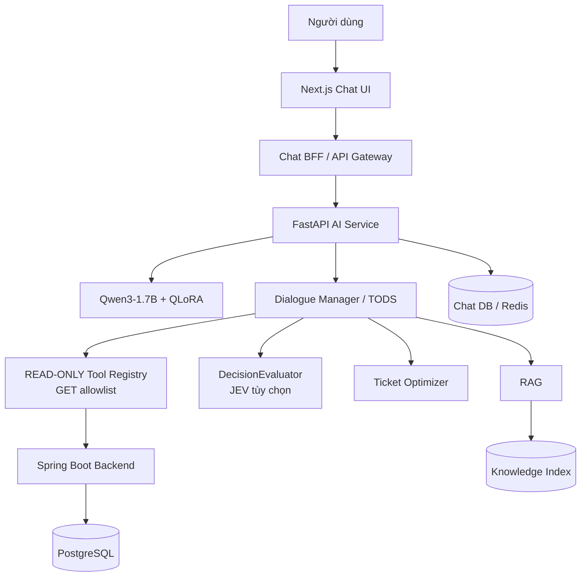

# 03 - Kiến trúc AI mục tiêu

## 1. Kiến trúc chốt



## 2. Nguyên tắc thiết kế

### Stateless service ở tầng compute

AI Service không giữ state quan trọng trong process memory. Conversation state có thể lưu qua repository abstraction ở **namespace chat do AI Service sở hữu**; Redis dùng cho state ngắn hạn/cache và PostgreSQL chat schema (nếu được phê duyệt) cho retention/audit. Quyền ghi chat state **không** được mở rộng sang database nghiệp vụ Spring Boot.

### Bộ cưỡng chế quyền đọc (bắt buộc)

- `ReadOnlyBusinessToolExecutor` chỉ chấp nhận tool có `method=GET`, endpoint đã đăng ký, schema đầu vào/đầu ra có kiểm tra.
- Không có `create_reservation`, `request_refund_review`, `create_order`, `payment`, `cancel`, `transfer` trong tool registry ở mọi giai đoạn.
- Các route như `/reservations/{eventId}` chỉ là **gợi ý navigation frontend**, không phải yêu cầu mutation hay xác nhận đã giữ chỗ.
- API riêng tư luôn đi qua cơ chế xác thực đã kiểm tra và quyền sở hữu backend.

### Hexagonal boundaries

- Domain: dialogue state, policy, constraints, optimizer.
- Application: orchestration/use-cases.
- Infrastructure: LLM, JEV, backend HTTP, database, Redis, retrieval.
- API: FastAPI route/schema/middleware.

Domain không import FastAPI/SQLAlchemy/httpx/SDK model provider.

## 3. Module đề xuất

```text
ai-service/
├── app/
│   ├── api/
│   ├── application/
│   ├── domain/
│   │   ├── dialogue/
│   │   ├── recommendation/
│   │   └── policies/
│   ├── models/
│   ├── rag/
│   ├── decisions/
│   ├── tools/
│   ├── integrations/
│   ├── persistence/
│   └── main.py
├── configs/
├── datasets/
├── training/
├── evaluations/
├── tests/
└── docs/
```

## 4. SLM role

Qwen3-1.7B + QLoRA chỉ chịu trách nhiệm tạo đầu ra có cấu trúc:

- `primary_intent`.
- `secondary_intents` nếu có.
- entities/slots phát hiện trong câu.
- `state_delta`.
- `proposed_action`.
- optional `ambiguities`.

SLM **không** trực tiếp quyết định transaction hoặc tạo dữ liệu event/ticket không có evidence.

## 5. Dialogue Manager/TODS

Nhiệm vụ:

- merge state delta bằng code xác định trước;
- kiểm tra required/conditional slots;
- resolve reference tới candidate đã hiển thị;
- chạy Policy Engine;
- enforce authentication/authorization;
- gọi tool thích hợp;
- xử lý tool result, stale data, retry/fallback;
- cập nhật conversation state.

## 6. RAG

RAG corpus gồm user-facing knowledge đã phê duyệt. Retrieval cần metadata:

- `source_id`;
- `title`;
- `version`;
- `effective_from/effective_to`;
- `access_level`;
- `document_type`.

Không index tài liệu nội bộ bảo mật vào public RAG corpus.

## 7. JEV

JEV triển khai qua abstraction:

```text
DecisionEvaluator
├── JevDecisionEvaluator
└── FallbackDecisionEvaluator
```

Vai trò cho phép:

- intent/router signal;
- đánh giá relevance/evidence của RAG;
- confidence signal.

Không dùng JEV cho arithmetic, payment truth, authorization hoặc hard business constraints.

## 8. Ticket Optimizer

Pipeline:

1. Candidate generation từ backend snapshot.
2. Hard constraint filtering.
3. Soft constraint scoring.
4. Ranking.
5. Alternative generation / constraint relaxation.
6. Đọc lại snapshot khi cần trước khi **khuyến nghị hoặc điều hướng**; không phát lệnh mutation.

Hard constraints không được nới:

- auth/ownership;
- event/sale status;
- purchase limit;
- available quantity;
- seat validity;
- reservation validity.

## 9. BFF và auth

Public tool có thể gọi không cần user token. Tool riêng tư phải có verified auth context.

Nguyên tắc:

- Browser không gửi provider API key.
- BFF không dùng role cookie làm bằng chứng quyền sở hữu object.
- Access token chỉ chuyển như credential transient tới layer cần thiết; không lưu trong conversation state/prompt/log.
- Backend Spring Security luôn là enforcement cuối cùng.

## 10. Observability tối thiểu

Mỗi chat request cần:

- `trace_id`/correlation ID;
- conversation ID;
- model route;
- tool names (không log secret/body nhạy cảm);
- latency theo stage;
- token/cost metrics khi provider cung cấp;
- policy decision;
- error category.
