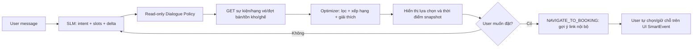

# 04 — Luồng nghiệp vụ READ-ONLY và state machine

## 1. Quy tắc toàn cục

AI chỉ thực hiện `READ → ANALYZE → EXPLAIN → RECOMMEND → NAVIGATE`. Không có nhánh AI giữ chỗ/đặt hàng/chuyển vé/yêu cầu hoàn tiền. Trạng thái đặt vé/đơn hàng bên dưới là **trạng thái quan sát qua GET** chứ không do chatbot gây ra.

## 2. Luồng tìm kiếm và tư vấn vé



- `NAVIGATE_TO_BOOKING` không gọi business API, không đặt ghế, không giữ số lượng, không khởi tạo đơn.
- Khi người dùng hỏi 'AI giữ vé giúp', phải nêu giới hạn quyền và dẫn tới `/reservations/{eventId}` (với `tier`, `phase`, `qty` nếu UI hỗ trợ). `/checkout?reservationId=...` **chỉ hợp lệ sau khi UI nghiệp vụ đã tạo reservation**.
- Sau khi chuyển trang, mọi cập nhật nghiệp vụ do người dùng thực hiện qua frontend/backend hiện tại, **không phải AI**.
- Kết quả inventory và seat là snapshot, có thể đổi bất kỳ lúc nào.

## 3. Ghế ngồi SEATED và khu đứng STANDING

- SEATED: GET area + seat statuses; ưu tiên mô tả ghế cùng hàng nếu đủ bằng chứng; `rowName/seatNumber` không tự động chứng minh gần nhau về hình học.
- STANDING: dùng hạng vé/đợt bán/số lượng; không bắt người dùng chọn `eventSeatId`.
- Vẽ sơ đồ ghế từ metadata có thực; không tự bịa tọa độ, đường đi hoặc cam kết ghế liền kề nếu backend chỉ có mã ghế.
- Không sinh payload `CreateReservationRequest` để gửi; nếu frontend có prefill thì frontend tự kiểm tra lại.

## 4. Tra cứu reservation/order/payment/ticket — CHỈ ĐỌC

- `get_active_reservation`, `get_reservation`: đọc trạng thái PENDING/CONFIRMED/EXPIRED/CANCELLED và `expiresAt` từ backend.
- `get_my_orders`, `get_order`: đọc order PENDING_PAYMENT/PAID/CANCELLED/EXPIRED/PARTIALLY_REFUNDED/REFUNDED; backend xác minh ownership.
- `get_payment_status`: đọc INITIATED/PENDING/SUCCESS/FAILED/CANCELLED/REFUNDED; tuyệt đối không suy luận payment SUCCESS đồng nghĩa có vé khi reservation đã hết hạn hoặc order bị hủy.
- `get_my_tickets`: đọc danh sách vé cá nhân qua token hợp lệ; không refresh QR, transfer, resend email, cancel ticket.
- Không tự tạo, cập nhật hoặc hủy bất kỳ đối tượng nào phía trên.

## 5. Hoàn tiền / hỗ trợ

- Có thể đọc `/api/v1/orders/{orderId}/refund-review` nếu xác thực là buyer chính chủ; trạng thái `REFUNDED_CONFIRMED` là kết quả đối soát thủ công, không phải chatbot đã thực hiện refund.
- Có thể RAG chính sách hoàn tiền đã được phê duyệt.
- **Không gọi `POST /refund-review`**, kể cả người dùng yêu cầu hoặc xác nhận. Chỉ chỉ dẫn người dùng mở tính năng hỗ trợ hoàn tiền tại trang tài khoản hoặc liên hệ kênh hỗ trợ được xác thực.
- `HUMAN_HANDOFF` là hướng dẫn/liên kết tới kênh hỗ trợ có sẵn; không tạo ticket support trong backend nếu việc đó phát sinh bản ghi.

## 6. Hội thoại nhiều lượt (state machine nội bộ)

```text
IDLE → UNDERSTANDING → COLLECTING_INFORMATION → READ_READY
  → FETCHING_READ_ONLY_DATA → ANALYZING → RECOMMENDING → ANSWERING
  → [WAITING_USER | NAVIGATION_SUGGESTED | COMPLETED]
```

Nhánh: `AUTH_REQUIRED`, `NO_RESULTS`, `STALE_SNAPSHOT`, `TOOL_UNAVAILABLE`, `OUT_OF_SCOPE`, `READ_ONLY_DENIAL`.

- `state_delta` cập nhật **state nội bộ cuộc hội thoại**, không liên quan state của reservation/order/payment.
- Không dùng `AWAITING_CONFIRMATION` cho nghiệp vụ ghi, `CREATE_RESERVATION`, `REFUND_SUBMITTED`, `ORDER_CREATED` làm trạng thái chatbot.
- Khi user sửa số lượng vé/ngân sách, cập nhật preference trong chat, **không chỉnh sửa giỏ hàng/đơn hàng backend**.

## 7. Ví dụ phản hồi bắt buộc

| Người dùng | Hành vi hợp lệ |
|---|---|
| 'Giữ giúp tôi 2 vé VIP' | Kiểm tra tồn kho bằng GET, giải thích chưa giữ vé và gợi ý nút 'Tự chọn vé'. |
| 'Hủy reservation này đi' | Đọc trạng thái nếu có auth, giải thích cách hủy trên giao diện; chatbot không gọi cancel. |
| 'Cho tôi hoàn tiền' | Đọc chính sách và hướng dẫn gửi yêu cầu ở giao diện tài khoản; không gửi POST. |
| 'Đổi 3 vé thành 2 vé' | Nếu đang tư vấn: chỉ cập nhật số lượng trong chat; nếu đã giữ chỗ: không sửa backend, hướng dẫn người dùng xử lý bằng UI. |
| 'Tôi đã thanh toán chưa?' | Chỉ đọc API auth + xác minh ID/ownership, phân biệt trạng thái payment và order. |

## 8. Xử lý stale snapshot

Mọi đề xuất là snapshot. Nếu người dùng quay lại lựa chọn: thực hiện GET mới nếu cần, cảnh báo khả dụng có thể đã thay đổi, điều hướng sang UI đã có kiểm tra cuối. Không có bước `revalidate → mutation` trong AI Service.
